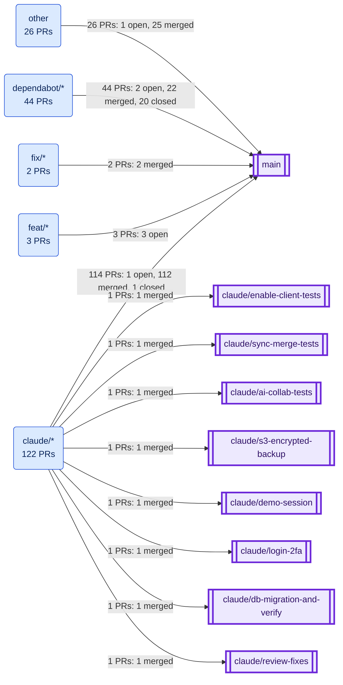
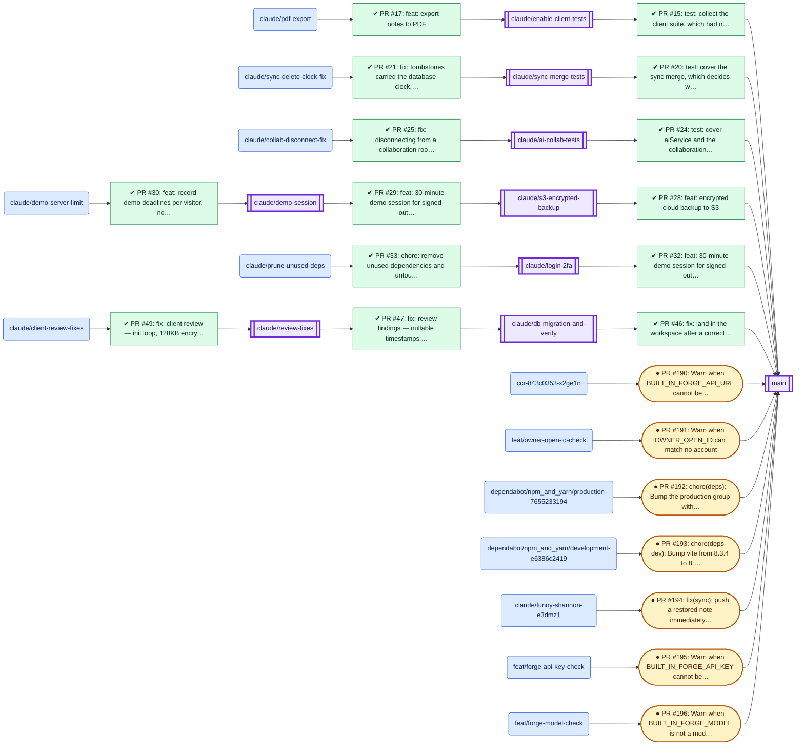
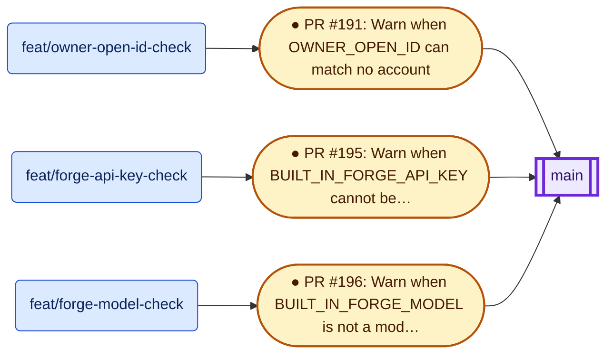
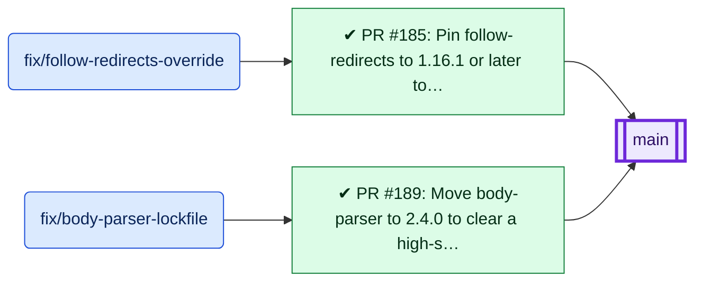

```mermaid
flowchart LR
  b68("dependabot/npm_and_yarn/npm_and_yarn-27833e7b9c"):::source
  b99[["main"]]:::target
  b69("dependabot/npm_and_yarn/npm_and_yarn-978e8b3dbc"):::source
  b49("dependabot/github_actions/actions/dependency-review-action-5"):::source
  b50("dependabot/github_actions/actions/setup-node-7"):::source
  b48("dependabot/github_actions/actions/checkout-7"):::source
  b70("dependabot/npm_and_yarn/production-09e46ccb0d"):::source
  b61("dependabot/npm_and_yarn/development-9eb7ac6116"):::source
  b67("dependabot/npm_and_yarn/nanoid-6.0.1"):::source
  b66("dependabot/npm_and_yarn/multi-b251156d90"):::source
  b88("dependabot/npm_and_yarn/vite-8.2.0"):::source
  b71("dependabot/npm_and_yarn/production-2fdcc012cf"):::source
  b53("dependabot/npm_and_yarn/development-1964815626"):::source
  b80("dependabot/npm_and_yarn/production-c3f1864764"):::source
  b89("dependabot/npm_and_yarn/vitejs/plugin-react-6.0.5"):::source
  b85("dependabot/npm_and_yarn/superjson-2.2.6"):::source
  b87("dependabot/npm_and_yarn/typescript-7.0.2"):::source
  b86("dependabot/npm_and_yarn/types/node-26.2.0"):::source
  b78("dependabot/npm_and_yarn/production-9c920bdf9d"):::source
  b72("dependabot/npm_and_yarn/production-31f7a13e02"):::source
  b59("dependabot/npm_and_yarn/development-788cdcced7"):::source
  b90("dependabot/npm_and_yarn/vitest-4.1.11"):::source
  b65("dependabot/npm_and_yarn/lucide-react-1.33.0"):::source
  b51("dependabot/npm_and_yarn/cookie-2.0.1"):::source
  b74("dependabot/npm_and_yarn/production-655c99dda2"):::source
  b77("dependabot/npm_and_yarn/production-92a56b7ac3"):::source
  b81("dependabot/npm_and_yarn/production-d0a67106f3"):::source
  b63("dependabot/npm_and_yarn/development-f0a30c9284"):::source
  b84("dependabot/npm_and_yarn/production-e6f33b74b1"):::source
  b57("dependabot/npm_and_yarn/development-6c01857aeb"):::source
  b91("dependabot/npm_and_yarn/vitest-5.0.0"):::source
  b73("dependabot/npm_and_yarn/production-650828bdd8"):::source
  b58("dependabot/npm_and_yarn/development-7287332dd0"):::source
  b75("dependabot/npm_and_yarn/production-758d29f2c4"):::source
  b60("dependabot/npm_and_yarn/development-82de031466"):::source
  b64("dependabot/npm_and_yarn/dotenv-18.0.1"):::source
  b83("dependabot/npm_and_yarn/production-dbd2f05899"):::source
  b52("dependabot/npm_and_yarn/development-16f901862d"):::source
  b82("dependabot/npm_and_yarn/production-db54ec02cd"):::source
  b54("dependabot/npm_and_yarn/development-2637b4e444"):::source
  b56("dependabot/npm_and_yarn/development-674bebbbf5"):::source
  b79("dependabot/npm_and_yarn/production-b5409b357d"):::source
  b55("dependabot/npm_and_yarn/development-5c9102ff68"):::source
  b76("dependabot/npm_and_yarn/production-7655233194"):::source
  b62("dependabot/npm_and_yarn/development-e6386c2419"):::source
  p31{{"✖ PR #31: chore(deps): Bump the npm_and_yarn group ac…"}}:::closed
  p35{{"✖ PR #35: chore(deps): Bump the npm_and_yarn group ac…"}}:::closed
  p38{{"✖ PR #38: chore(deps): Bump actions/dependency-review…"}}:::closed
  p39{{"✖ PR #39: chore(deps): Bump actions/setup-node from 4…"}}:::closed
  p40{{"✖ PR #40: chore(deps): Bump actions/checkout from 5 t…"}}:::closed
  p41{{"✖ PR #41: chore(deps): Bump jose from 6.1.0 to 6.2.8…"}}:::closed
  p42{{"✖ PR #42: chore(deps-dev): Bump vite-plugin-manus-run…"}}:::closed
  p43{{"✖ PR #43: chore(deps): Bump nanoid from 5.1.16 to 6.0…"}}:::closed
  p44{{"✖ PR #44: chore(deps): Bump express and @types/express"}}:::closed
  p45{{"✖ PR #45: chore(deps-dev): Bump vite from 7.3.6 to 8.…"}}:::closed
  p48{{"✖ PR #48: chore(deps): Bump the production group acro…"}}:::closed
  p53["✔ PR #53: chore(deps-dev): Bump the development group…"]:::merged
  p57{{"✖ PR #57: chore(deps): Bump the production group with…"}}:::closed
  p58{{"✖ PR #58: chore(deps-dev): Bump @vitejs/plugin-react…"}}:::closed
  p59{{"✖ PR #59: chore(deps): Bump superjson from 1.13.3 to…"}}:::closed
  p60{{"✖ PR #60: chore(deps-dev): Bump typescript from 5.9.3…"}}:::closed
  p61{{"✖ PR #61: chore(deps-dev): Bump @types/node from 24.1…"}}:::closed
  p66["✔ PR #66: chore(deps): Bump the production group acro…"]:::merged
  p70{{"✖ PR #70: chore(deps): Bump jose from 6.2.9 to 6.2.10…"}}:::closed
  p71["✔ PR #71: chore(deps-dev): Bump vite from 8.2.1 to 8.…"]:::merged
  p72["✔ PR #72: chore(deps-dev): Bump vitest from 3.2.7 to…"]:::merged
  p73["✔ PR #73: chore(deps): Bump lucide-react from 0.453.0…"]:::merged
  p74{{"✖ PR #74: chore(deps): Bump cookie from 1.1.1 to 2.0.1"}}:::closed
  p77{{"✖ PR #77: chore(deps): Bump the production group acro…"}}:::closed
  p78["✔ PR #78: chore(deps): Bump the production group acro…"]:::merged
  p82["✔ PR #82: chore(deps): Bump the production group with…"]:::merged
  p83["✔ PR #83: chore(deps-dev): Bump the development group…"]:::merged
  p102["✔ PR #102: chore(deps): Bump the production group acro…"]:::merged
  p103["✔ PR #103: chore(deps-dev): Bump the development group…"]:::merged
  p104["✔ PR #104: chore(deps-dev): Bump vitest from 4.1.11 to…"]:::merged
  p109["✔ PR #109: chore(deps): Bump the production group with…"]:::merged
  p110["✔ PR #110: chore(deps-dev): Bump the development group…"]:::merged
  p120["✔ PR #120: chore(deps): Bump the production group with…"]:::merged
  p121["✔ PR #121: chore(deps-dev): Bump the development group…"]:::merged
  p122["✔ PR #122: chore(deps): Bump dotenv from 17.4.2 to 18.…"]:::merged
  p144["✔ PR #144: chore(deps): Bump the production group with…"]:::merged
  p145["✔ PR #145: chore(deps-dev): Bump the development group…"]:::merged
  p157["✔ PR #157: chore(deps): Bump the production group with…"]:::merged
  p159{{"✖ PR #159: chore(deps-dev): Bump the development group…"}}:::closed
  p160["✔ PR #160: chore(deps-dev): Bump the development group…"]:::merged
  p180["✔ PR #180: chore(deps): Bump the production group with…"]:::merged
  p181["✔ PR #181: chore(deps-dev): Bump the development group…"]:::merged
  p192(["● PR #192: chore(deps): Bump the production group with…"]):::open
  p193(["● PR #193: chore(deps-dev): Bump vite from 8.3.4 to 8.…"]):::open
  b68 --> p31
  p31 --> b99
  b69 --> p35
  p35 --> b99
  b49 --> p38
  p38 --> b99
  b50 --> p39
  p39 --> b99
  b48 --> p40
  p40 --> b99
  b70 --> p41
  p41 --> b99
  b61 --> p42
  p42 --> b99
  b67 --> p43
  p43 --> b99
  b66 --> p44
  p44 --> b99
  b88 --> p45
  p45 --> b99
  b71 --> p48
  p48 --> b99
  b53 --> p53
  p53 --> b99
  b80 --> p57
  p57 --> b99
  b89 --> p58
  p58 --> b99
  b85 --> p59
  p59 --> b99
  b87 --> p60
  p60 --> b99
  b86 --> p61
  p61 --> b99
  b78 --> p66
  p66 --> b99
  b72 --> p70
  p70 --> b99
  b59 --> p71
  p71 --> b99
  b90 --> p72
  p72 --> b99
  b65 --> p73
  p73 --> b99
  b51 --> p74
  p74 --> b99
  b74 --> p77
  p77 --> b99
  b77 --> p78
  p78 --> b99
  b81 --> p82
  p82 --> b99
  b63 --> p83
  p83 --> b99
  b84 --> p102
  p102 --> b99
  b57 --> p103
  p103 --> b99
  b91 --> p104
  p104 --> b99
  b73 --> p109
  p109 --> b99
  b58 --> p110
  p110 --> b99
  b75 --> p120
  p120 --> b99
  b60 --> p121
  p121 --> b99
  b64 --> p122
  p122 --> b99
  b83 --> p144
  p144 --> b99
  b52 --> p145
  p145 --> b99
  b82 --> p157
  p157 --> b99
  b54 --> p159
  p159 --> b99
  b56 --> p160
  p160 --> b99
  b79 --> p180
  p180 --> b99
  b55 --> p181
  p181 --> b99
  b76 --> p192
  p192 --> b99
  b62 --> p193
  p193 --> b99
  classDef source fill:#dbeafe,stroke:#1d4ed8,color:#0b2559
  classDef target fill:#ede9fe,stroke:#6d28d9,stroke-width:3px,color:#2e1065
  classDef open fill:#fef3c7,stroke:#b45309,stroke-width:2px,color:#451a03
  classDef merged fill:#dcfce7,stroke:#15803d,color:#052e16
  classDef closed fill:#f3f4f6,stroke:#b91c1c,stroke-dasharray:5 3,color:#111827
```

# PR ↔ Branch Visualization

<!-- Generated by scripts/pr-visualization.mjs — edit the script, not this file. -->

## A. Overview

This document maps every pull request in [VijayKumaro7/NotionAI_Notepad](https://github.com/VijayKumaro7/NotionAI_Notepad) to the branch it came from and the branch it targets, so you can tell at a glance which PRs originated from which branches, where they landed, and what state they are in.

- **197 pull requests** (169 merged, 7 open, 21 closed without merging)
- **100 branches** appear either in a PR or in the current branch list
- **189 PRs target `main`**; **8** target another branch (stacked PRs, section E)

Everything below is read straight from GitHub's PR metadata. Where a statement is an inference rather than a recorded fact, it is labelled as one.

An interactive version (zoom, pan, filter, click a node for details, double-click to open the PR) is in [`pr-branch-visualization.html`](pr-branch-visualization.html). Open it in a browser; it loads Cytoscape.js from a CDN.

## B. Visualization

Direction is always **source branch → PR → target branch**.

### Legend

| Encoding | Meaning |
|---|---|
| Rounded blue node | Branch used only as a PR source in that diagram |
| Double-bordered purple node `[[ ]]` | Branch that PRs in that diagram merge **into** (target) |
| ✔ green rectangle | Merged PR |
| ● amber stadium with thick border | Open PR |
| ✖ grey hexagon, dashed red border | Closed without merging |

Status is carried by the icon and the shape as well as the colour, so it survives greyscale and colour-blindness. GitHub does not make Mermaid nodes clickable; use the inventory table (section C) or the HTML version for links.

### 1. Overview — branch families → target branches

Source branches are grouped by name prefix (a naming convention, not metadata). Edge labels give the PR count and status split.

### 2. Stacked and open PRs

PRs that target a branch other than `main`, the PRs that produced those branches, and every open PR. These are the relationships that are not simply "branch → main".

### 3. Every PR, by branch family

One diagram per family so each stays readable. Expand a section to see it.

```mermaid
flowchart LR
  b27("claude/implement-todo-item-UspXU"):::source
  b99[["main"]]:::target
  b28("claude/implement-todo-item-ZxcqX"):::source
  b24("claude/home-page-display-vxmrwh"):::source
  b18("claude/deploy-express-server"):::source
  b46("claude/template-selector-layout"):::source
  b23("claude/global-heading-scale"):::source
  b19[["claude/enable-client-tests"]]:::target
  b41("claude/small-correctness-fixes"):::source
  b30("claude/pdf-export"):::source
  b11("claude/code-split-jspdf"):::source
  b42("claude/strip-dev-runtime-prod"):::source
  b44[["claude/sync-merge-tests"]]:::target
  b43("claude/sync-delete-clock-fix"):::source
  b38("claude/sharing-activity-log"):::source
  b45("claude/template-placeholders"):::source
  b7[["claude/ai-collab-tests"]]:::target
  b13("claude/collab-disconnect-fix"):::source
  b33("claude/render-deploy-config"):::source
  b35[["claude/s3-encrypted-backup"]]:::target
  b16[["claude/demo-session"]]:::target
  b15("claude/demo-server-limit"):::source
  b29[["claude/login-2fa"]]:::target
  b31("claude/prune-unused-deps"):::source
  b37("claude/security-updates"):::source
  b36("claude/security-policy-ci"):::source
  b14[["claude/db-migration-and-verify"]]:::target
  b34[["claude/review-fixes"]]:::target
  b9("claude/client-review-fixes"):::source
  b32("claude/readme-accuracy"):::source
  b17("claude/dependabot-batch"):::source
  b25("claude/homepage-hero-image-sfiaal"):::source
  b10("claude/code-scanning-security-hur004"):::source
  b12("claude/codeql-alerts-hur004"):::source
  b8("claude/chat-api-requirements-d4ztox"):::source
  b20("claude/exciting-cori-twonpn"):::source
  b40("claude/sharp-brahmagupta-n7ckwv"):::source
  b26("claude/hopeful-ramanujan-8lt1no"):::source
  b21("claude/funny-shannon-e3dmz1"):::source
  b22("claude/funny-wright-oau8dk"):::source
  b47("claude/upbeat-galileo-h2doxd"):::source
  b39("claude/sharp-archimedes-cvyw57"):::source
  p2["✔ PR #2: Implement server-side notes feature (resolv…"]:::merged
  p3["✔ PR #3: Implement filter and organize notes by tags"]:::merged
  p4["✔ PR #4: Claude/implement todo item usp xu"]:::merged
  p5["✔ PR #5: docs: rewrite README with professional stru…"]:::merged
  p6["✔ PR #6: Claude/implement todo item usp xu"]:::merged
  p7["✔ PR #7: Claude/implement todo item usp xu"]:::merged
  p9["✔ PR #9: Claude/implement todo item usp xu"]:::merged
  p10["✔ PR #10: Redirect authenticated users to workspace i…"]:::merged
  p11["✔ PR #11: fix: auth failure put the app in an infinit…"]:::merged
  p12["✔ PR #12: feat: make the Express server deployable to…"]:::merged
  p13["✔ PR #13: fix: template picker text was oversized and…"]:::merged
  p14["✔ PR #14: fix: heading sizes set by components were i…"]:::merged
  p15["✔ PR #15: test: collect the client suite, which had n…"]:::merged
  p16["✔ PR #16: fix: OAuth failures showed raw JSON; auth h…"]:::merged
  p17["✔ PR #17: feat: export notes to PDF"]:::merged
  p18["✔ PR #18: perf: load jsPDF on demand instead of in th…"]:::merged
  p19["✔ PR #19: perf: keep dev-only Vite plugins out of pro…"]:::merged
  p20["✔ PR #20: test: cover the sync merge, which decides w…"]:::merged
  p21["✔ PR #21: fix: tombstones carried the database clock,…"]:::merged
  p22["✔ PR #22: feat: sharing history and activity log"]:::merged
  p23["✔ PR #23: feat: fill in template placeholders before…"]:::merged
  p24["✔ PR #24: test: cover aiService and the collaboration…"]:::merged
  p25["✔ PR #25: fix: disconnecting from a collaboration roo…"]:::merged
  p26["✔ PR #26: chore: add a Render blueprint for deploying…"]:::merged
  p27["✔ PR #27: fix: disconnecting from a collaboration roo…"]:::merged
  p28["✔ PR #28: feat: encrypted cloud backup to S3"]:::merged
  p29["✔ PR #29: feat: 30-minute demo session for signed-out…"]:::merged
  p30["✔ PR #30: feat: record demo deadlines per visitor, no…"]:::merged
  p32["✔ PR #32: feat: 30-minute demo session for signed-out…"]:::merged
  p33["✔ PR #33: chore: remove unused dependencies and untou…"]:::merged
  p34["✔ PR #34: chore: remove unused dependencies and untou…"]:::merged
  p36["✔ PR #36: chore(deps): clear all 80 dependency vulner…"]:::merged
  p37["✔ PR #37: ci: gate every pull request on a security p…"]:::merged
  p46["✔ PR #46: fix: land in the workspace after a correct…"]:::merged
  p47["✔ PR #47: fix: review findings — nullable timestamps,…"]:::merged
  p49["✔ PR #49: fix: client review — init loop, 128KB encry…"]:::merged
  p50["✔ PR #50: docs: correct the README where it did not m…"]:::merged
  p51["✔ PR #51: fix: bring the stranded review fixes onto m…"]:::merged
  p52["✔ PR #52: chore(deps): take all eight Dependabot bump…"]:::merged
  p54["✔ PR #54: ci: boot the server in CI and check it actu…"]:::merged
  p55["✔ PR #55: Claude/home page display vxmrwh"]:::merged
  p56["✔ PR #56: fix(ui): make the workspace usable below 10…"]:::merged
  p62["✔ PR #62: Claude/home page display vxmrwh"]:::merged
  p63["✔ PR #63: Claude/home page display vxmrwh"]:::merged
  p64["✔ PR #64: Claude/home page display vxmrwh"]:::merged
  p65["✔ PR #65: chore(deps): take all five Dependabot updat…"]:::merged
  p67["✔ PR #67: feat: persist collaborative edits back to t…"]:::merged
  p68["✔ PR #68: Make the Render deploy work, and stop repor…"]:::merged
  p69["✔ PR #69: docs: add screenshots of the app to the REA…"]:::merged
  p75["✔ PR #75: Claude/implement todo item usp xu"]:::merged
  p76["✔ PR #76: feat(collab): replace positional ops with a…"]:::merged
  p79["✔ PR #79: Add HeroWorkspacePreview SVG component for…"]:::merged
  p80["✔ PR #80: Fix client address detection behind proxies"]:::merged
  p81["✔ PR #81: fix(security): resolve the six open CodeQL…"]:::merged
  p84["✔ PR #84: fix(security): resolve the six open CodeQL…"]:::merged
  p85["✔ PR #85: fix(security): resolve the six open CodeQL…"]:::merged
  p86["✔ PR #86: fix(auth): show Google sign-in failures ins…"]:::merged
  p87["✔ PR #87: fix(security): rate limit the express route…"]:::merged
  p88["✔ PR #88: fix(security): write the flow cookie's 'sec…"]:::merged
  p89["✔ PR #89: Add conversational AI chat assistant"]:::merged
  p90["✔ PR #90: Let people choose not to save a chat, and h…"]:::merged
  p91["✔ PR #91: Send security headers, require HTTPS, and s…"]:::merged
  p92["✔ PR #92: fix(deps): take qs 6.16.0, which patches bo…"]:::merged
  p93["✔ PR #93: Name the environment variable the AI code a…"]:::merged
  p94["✔ PR #94: Put the assistant's operations inside the c…"]:::merged
  p95["✔ PR #95: Make cancelling an AI request stop the work…"]:::merged
  p96["✔ PR #96: Stop publishing a development-only script,…"]:::merged
  p97["✔ PR #97: Move toasts off the controls they were cove…"]:::merged
  p98["✔ PR #98: Pull the chat box's decisions out where tes…"]:::merged
  p99["✔ PR #99: Load a page when its route is reached, not…"]:::merged
  p100["✔ PR #100: Fix seven defects in the chat box"]:::merged
  p101["✔ PR #101: Stopping a request must let go of it, not o…"]:::merged
  p105["✔ PR #105: Let the provider's model names move with it…"]:::merged
  p106["✔ PR #106: Sign-in portal hidden where it cannot work,…"]:::merged
  p107["✔ PR #107: Privacy page, account deletion, and sync th…"]:::merged
  p108["✔ PR #108: Sync that says whether it worked, and a way…"]:::merged
  p111["✔ PR #111: Stop the stylesheet overruling the call site"]:::merged
  p112["✔ PR #112: Keep both versions when two devices edit on…"]:::merged
  p113["✔ PR #113: Make sessions revocable: add session store…"]:::merged
  p114["✔ PR #114: Let the key follow you to another device"]:::merged
  p115["✔ PR #115: Encrypt version history, and fix the restor…"]:::merged
  p116["✔ PR #116: Stop a sync overwriting the note you are lo…"]:::merged
  p117["✔ PR #117: Stop a sync-installed note re-entering the…"]:::merged
  p118["✔ PR #118: Add local-only mode for static deployments…"]:::merged
  p119["✔ PR #119: Stop the cookie notice describing cookies n…"]:::merged
  p123["✔ PR #123: Open the sidebar on the notes that are in it"]:::merged
  p124["✔ PR #124: Nested folders: draw them, drag them, and s…"]:::merged
  p125["✔ PR #125: Make disaster recovery something you can re…"]:::merged
  p126["✔ PR #126: Test two devices against a real database"]:::merged
  p127["✔ PR #127: Test the wiring, and fix the bug that found"]:::merged
  p128["✔ PR #128: Make a deletion stick, and stop the hook sy…"]:::merged
  p129["✔ PR #129: Drag a note onto a folder row to file it th…"]:::merged
  p130["✔ PR #130: Cover the order runSync applies a plan in,…"]:::merged
  p131["✔ PR #131: Run the real build in a real browser, at le…"]:::merged
  p132{{"✖ PR #132: Decrypt a batch of notes together, not one…"}}:::closed
  p133["✔ PR #133: Decrypt a workspace all at once, and stop t…"]:::merged
  p134["✔ PR #134: Deleting a folder no longer strands the not…"]:::merged
  p135["✔ PR #135: Stop copy buttons claiming success when the…"]:::merged
  p136["✔ PR #136: Profile the real app, and stop guessing at…"]:::merged
  p137["✔ PR #137: Stop leaking a voice memo's blob URL, and i…"]:::merged
  p139["✔ PR #139: Stop labelling every voice memo as audio/we…"]:::merged
  p140["✔ PR #140: Fix two more VoiceMemo races a follow-up re…"]:::merged
  p141["✔ PR #141: Call dataTransfer.setData so dragging a not…"]:::merged
  p142["✔ PR #142: Disclose server-side sessions, security log…"]:::merged
  p143["✔ PR #143: Stop the shortcuts footer naming a key Wind…"]:::merged
  p146["✔ PR #146: Move .container into @layer components, whe…"]:::merged
  p147["✔ PR #147: Wire the Formatting shortcuts ShortcutsModa…"]:::merged
  p148["✔ PR #148: Build the command palette lib/shortcuts.ts…"]:::merged
  p154["✔ PR #154: fix(deps): patch ip-address and dompurify a…"]:::merged
  p166["✔ PR #166: Redesign: editorial landing and login, quie…"]:::merged
  p167["✔ PR #167: Set the workspace in Concept A's fonts (New…"]:::merged
  p169["✔ PR #169: Template line icons, and in-app drawings fo…"]:::merged
  p171["✔ PR #171: Hover and focus states: one visible focus s…"]:::merged
  p173["✔ PR #173: Load the workspace fonts only when the work…"]:::merged
  p174["✔ PR #174: Remove the CloudFront image allowance from…"]:::merged
  p176["✔ PR #176: docs: refresh README screenshots and trim i…"]:::merged
  p178["✔ PR #178: docs: add CONFIGURATION.md and link it from…"]:::merged
  p184["✔ PR #184: feat(editor): wire Cmd+Z / Cmd+Shift+Z undo…"]:::merged
  p186["✔ PR #186: fix(editor): make Cmd+S flush the autosave…"]:::merged
  p188["✔ PR #188: Sync restore tests, dvh app shells, and bac…"]:::merged
  p194(["● PR #194: fix(sync): push a restored note immediately…"]):::open
  p197["✔ PR #197: docs: PR ↔ branch visualization and generat…"]:::merged
  b27 --> p2
  p2 --> b99
  b28 --> p3
  p3 --> b99
  b27 --> p4
  p4 --> b99
  b27 --> p5
  p5 --> b99
  b27 --> p6
  p6 --> b99
  b27 --> p7
  p7 --> b99
  b27 --> p9
  p9 --> b99
  b24 --> p10
  p10 --> b99
  b24 --> p11
  p11 --> b99
  b18 --> p12
  p12 --> b99
  b46 --> p13
  p13 --> b99
  b23 --> p14
  p14 --> b99
  b19 --> p15
  p15 --> b99
  b41 --> p16
  p16 --> b99
  b30 --> p17
  p17 --> b19
  b11 --> p18
  p18 --> b99
  b42 --> p19
  p19 --> b99
  b44 --> p20
  p20 --> b99
  b43 --> p21
  p21 --> b44
  b38 --> p22
  p22 --> b99
  b45 --> p23
  p23 --> b99
  b7 --> p24
  p24 --> b99
  b13 --> p25
  p25 --> b7
  b33 --> p26
  p26 --> b99
  b13 --> p27
  p27 --> b99
  b35 --> p28
  p28 --> b99
  b16 --> p29
  p29 --> b35
  b15 --> p30
  p30 --> b16
  b29 --> p32
  p32 --> b99
  b31 --> p33
  p33 --> b29
  b31 --> p34
  p34 --> b99
  b37 --> p36
  p36 --> b99
  b36 --> p37
  p37 --> b99
  b14 --> p46
  p46 --> b99
  b34 --> p47
  p47 --> b14
  b9 --> p49
  p49 --> b34
  b32 --> p50
  p50 --> b99
  b9 --> p51
  p51 --> b99
  b17 --> p52
  p52 --> b99
  b24 --> p54
  p54 --> b99
  b24 --> p55
  p55 --> b99
  b24 --> p56
  p56 --> b99
  b24 --> p62
  p62 --> b99
  b24 --> p63
  p63 --> b99
  b24 --> p64
  p64 --> b99
  b24 --> p65
  p65 --> b99
  b27 --> p67
  p67 --> b99
  b24 --> p68
  p68 --> b99
  b27 --> p69
  p69 --> b99
  b27 --> p75
  p75 --> b99
  b27 --> p76
  p76 --> b99
  b25 --> p79
  p79 --> b99
  b10 --> p80
  p80 --> b99
  b10 --> p81
  p81 --> b99
  b10 --> p84
  p84 --> b99
  b12 --> p85
  p85 --> b99
  b10 --> p86
  p86 --> b99
  b10 --> p87
  p87 --> b99
  b10 --> p88
  p88 --> b99
  b8 --> p89
  p89 --> b99
  b8 --> p90
  p90 --> b99
  b8 --> p91
  p91 --> b99
  b10 --> p92
  p92 --> b99
  b8 --> p93
  p93 --> b99
  b8 --> p94
  p94 --> b99
  b8 --> p95
  p95 --> b99
  b8 --> p96
  p96 --> b99
  b8 --> p97
  p97 --> b99
  b8 --> p98
  p98 --> b99
  b8 --> p99
  p99 --> b99
  b8 --> p100
  p100 --> b99
  b8 --> p101
  p101 --> b99
  b8 --> p105
  p105 --> b99
  b8 --> p106
  p106 --> b99
  b8 --> p107
  p107 --> b99
  b8 --> p108
  p108 --> b99
  b8 --> p111
  p111 --> b99
  b8 --> p112
  p112 --> b99
  b20 --> p113
  p113 --> b99
  b20 --> p114
  p114 --> b99
  b20 --> p115
  p115 --> b99
  b20 --> p116
  p116 --> b99
  b40 --> p117
  p117 --> b99
  b26 --> p118
  p118 --> b99
  b26 --> p119
  p119 --> b99
  b26 --> p123
  p123 --> b99
  b26 --> p124
  p124 --> b99
  b40 --> p125
  p125 --> b99
  b20 --> p126
  p126 --> b99
  b40 --> p127
  p127 --> b99
  b20 --> p128
  p128 --> b99
  b26 --> p129
  p129 --> b99
  b40 --> p130
  p130 --> b99
  b40 --> p131
  p131 --> b99
  b40 --> p132
  p132 --> b99
  b20 --> p133
  p133 --> b99
  b26 --> p134
  p134 --> b99
  b20 --> p135
  p135 --> b99
  b40 --> p136
  p136 --> b99
  b20 --> p137
  p137 --> b99
  b40 --> p139
  p139 --> b99
  b20 --> p140
  p140 --> b99
  b40 --> p141
  p141 --> b99
  b40 --> p142
  p142 --> b99
  b40 --> p143
  p143 --> b99
  b40 --> p146
  p146 --> b99
  b40 --> p147
  p147 --> b99
  b40 --> p148
  p148 --> b99
  b21 --> p154
  p154 --> b99
  b22 --> p166
  p166 --> b99
  b22 --> p167
  p167 --> b99
  b22 --> p169
  p169 --> b99
  b22 --> p171
  p171 --> b99
  b22 --> p173
  p173 --> b99
  b22 --> p174
  p174 --> b99
  b47 --> p176
  p176 --> b99
  b47 --> p178
  p178 --> b99
  b21 --> p184
  p184 --> b99
  b21 --> p186
  p186 --> b99
  b21 --> p188
  p188 --> b99
  b21 --> p194
  p194 --> b99
  b39 --> p197
  p197 --> b99
  classDef source fill:#dbeafe,stroke:#1d4ed8,color:#0b2559
  classDef target fill:#ede9fe,stroke:#6d28d9,stroke-width:3px,color:#2e1065
  classDef open fill:#fef3c7,stroke:#b45309,stroke-width:2px,color:#451a03
  classDef merged fill:#dcfce7,stroke:#15803d,color:#052e16
  classDef closed fill:#f3f4f6,stroke:#b91c1c,stroke-dasharray:5 3,color:#111827
```

<b>claude/\*</b> — 122 PRs from 41 branches

<b>dependabot/\*</b> — 44 PRs from 44 branches

<b>feat/\*</b> — 3 PRs from 3 branches

<b>fix/\*</b> — 2 PRs from 2 branches

<b>other</b> — 26 PRs from 4 branches

```mermaid
flowchart LR
  b0("VijayKumaro7-patch-1"):::source
  b99[["main"]]:::target
  b1("agent-page-loading-issues-5969"):::source
  b5("ccr-267c97b9-v3gdqn"):::source
  b6("ccr-843c0353-x2ge1n"):::source
  p1["✔ PR #1: Add files via upload"]:::merged
  p8["✔ PR #8: Troubleshooting page loading issues"]:::merged
  p138["✔ PR #138: Add an nginx reverse-proxy config for self-…"]:::merged
  p149["✔ PR #149: Refuse to issue a session when VITE_APP_ID…"]:::merged
  p150["✔ PR #150: Stop leaking server details in error respon…"]:::merged
  p151["✔ PR #151: Answer Express-level errors with a status,…"]:::merged
  p152["✔ PR #152: Log 4xx errors from the Express handler, wi…"]:::merged
  p153["✔ PR #153: Cap the log lines a flood of bad requests c…"]:::merged
  p155["✔ PR #155: Rate limit requests before the body parsers…"]:::merged
  p156["✔ PR #156: Give notes sync its own, higher rate limit"]:::merged
  p158["✔ PR #158: Keep email accounts with no name signed in"]:::merged
  p161["✔ PR #161: Refuse to start when sign-in is possible bu…"]:::merged
  p162["✔ PR #162: Warn at startup about a JWT_SECRET shorter…"]:::merged
  p163["✔ PR #163: Warn when JWT_SECRET is long enough but gue…"]:::merged
  p164["✔ PR #164: Refuse to start when DATABASE_URL can never…"]:::merged
  p165["✔ PR #165: Startup checks for VITE_APP_ID, PORT and NO…"]:::merged
  p168["✔ PR #168: Warn when TRUSTED_PROXY_HOPS does not mean…"]:::merged
  p170["✔ PR #170: Startup warnings for DEMO_LIMIT_SALT, S3 ba…"]:::merged
  p172["✔ PR #172: Startup warnings for GOOGLE_CLIENT_SECRET a…"]:::merged
  p175["✔ PR #175: Warn when RECAPTCHA_SECRET_KEY is missing i…"]:::merged
  p177["✔ PR #177: Warn when RECAPTCHA_SITE_KEY is mangled, a…"]:::merged
  p179["✔ PR #179: Warn when S3_ACCESS_KEY_ID or S3_SECRET_ACC…"]:::merged
  p182["✔ PR #182: Warn when AWS_ACCESS_KEY_ID is mangled or o…"]:::merged
  p183["✔ PR #183: Warn when AWS_SECRET_ACCESS_KEY has whitesp…"]:::merged
  p187["✔ PR #187: Warn when AWS_SESSION_TOKEN is mangled, orp…"]:::merged
  p190(["● PR #190: Warn when BUILT_IN_FORGE_API_URL cannot be…"]):::open
  b0 --> p1
  p1 --> b99
  b1 --> p8
  p8 --> b99
  b5 --> p138
  p138 --> b99
  b6 --> p149
  p149 --> b99
  b6 --> p150
  p150 --> b99
  b6 --> p151
  p151 --> b99
  b6 --> p152
  p152 --> b99
  b6 --> p153
  p153 --> b99
  b6 --> p155
  p155 --> b99
  b6 --> p156
  p156 --> b99
  b6 --> p158
  p158 --> b99
  b6 --> p161
  p161 --> b99
  b6 --> p162
  p162 --> b99
  b6 --> p163
  p163 --> b99
  b6 --> p164
  p164 --> b99
  b6 --> p165
  p165 --> b99
  b6 --> p168
  p168 --> b99
  b6 --> p170
  p170 --> b99
  b6 --> p172
  p172 --> b99
  b6 --> p175
  p175 --> b99
  b6 --> p177
  p177 --> b99
  b6 --> p179
  p179 --> b99
  b6 --> p182
  p182 --> b99
  b6 --> p183
  p183 --> b99
  b6 --> p187
  p187 --> b99
  b6 --> p190
  p190 --> b99
  classDef source fill:#dbeafe,stroke:#1d4ed8,color:#0b2559
  classDef target fill:#ede9fe,stroke:#6d28d9,stroke-width:3px,color:#2e1065
  classDef open fill:#fef3c7,stroke:#b45309,stroke-width:2px,color:#451a03
  classDef merged fill:#dcfce7,stroke:#15803d,color:#052e16
  classDef closed fill:#f3f4f6,stroke:#b91c1c,stroke-dasharray:5 3,color:#111827
```

## C. Pull Request Inventory

All 197 PRs (open, merged and closed) in VijayKumaro7/NotionAI_Notepad, oldest first. Nothing was filtered out; see section F for the retrieval details.

| PR | Title | Source Branch | Target Branch | Status | Author | PR Link | Created | Merged / Closed |
|---|---|---|---|---|---|---|---|---|
| #1 | Add files via upload | `VijayKumaro7-patch-1` | `main` | Merged | VijayKumaro7 | [Link](https://github.com/VijayKumaro7/NotionAI_Notepad/pull/1) | 2026-03-06 | 2026-03-06 (merged) |
| #2 | Implement server-side notes feature (resolves 3 TODO scaffolding comments) | `claude/implement-todo-item-UspXU` | `main` | Merged | VijayKumaro7 | [Link](https://github.com/VijayKumaro7/NotionAI_Notepad/pull/2) | 2026-03-13 | 2026-03-13 (merged) |
| #3 | Implement filter and organize notes by tags | `claude/implement-todo-item-ZxcqX` | `main` | Merged | VijayKumaro7 | [Link](https://github.com/VijayKumaro7/NotionAI_Notepad/pull/3) | 2026-03-23 | 2026-03-23 (merged) |
| #4 | Claude/implement todo item usp xu | `claude/implement-todo-item-UspXU` | `main` | Merged | VijayKumaro7 | [Link](https://github.com/VijayKumaro7/NotionAI_Notepad/pull/4) | 2026-07-20 | 2026-07-20 (merged) |
| #5 | docs: rewrite README with professional structure and tone | `claude/implement-todo-item-UspXU` | `main` | Merged | VijayKumaro7 | [Link](https://github.com/VijayKumaro7/NotionAI_Notepad/pull/5) | 2026-07-21 | 2026-07-21 (merged) |
| #6 | Claude/implement todo item usp xu | `claude/implement-todo-item-UspXU` | `main` | Merged | VijayKumaro7 | [Link](https://github.com/VijayKumaro7/NotionAI_Notepad/pull/6) | 2026-07-24 | 2026-07-24 (merged) |
| #7 | Claude/implement todo item usp xu | `claude/implement-todo-item-UspXU` | `main` | Merged | VijayKumaro7 | [Link](https://github.com/VijayKumaro7/NotionAI_Notepad/pull/7) | 2026-07-25 | 2026-07-25 (merged) |
| #8 | Troubleshooting page loading issues | `agent-page-loading-issues-5969` | `main` | Merged | netlify-coding\[bot\] | [Link](https://github.com/VijayKumaro7/NotionAI_Notepad/pull/8) | 2026-07-26 | 2026-07-26 (merged) |
| #9 | Claude/implement todo item usp xu | `claude/implement-todo-item-UspXU` | `main` | Merged | VijayKumaro7 | [Link](https://github.com/VijayKumaro7/NotionAI_Notepad/pull/9) | 2026-07-27 | 2026-07-27 (merged) |
| #10 | Redirect authenticated users to workspace instead of landing page | `claude/home-page-display-vxmrwh` | `main` | Merged | VijayKumaro7 | [Link](https://github.com/VijayKumaro7/NotionAI_Notepad/pull/10) | 2026-07-27 | 2026-07-27 (merged) |
| #11 | fix: auth failure put the app in an infinite reload loop | `claude/home-page-display-vxmrwh` | `main` | Merged | VijayKumaro7 | [Link](https://github.com/VijayKumaro7/NotionAI_Notepad/pull/11) | 2026-07-27 | 2026-07-27 (merged) |
| #12 | feat: make the Express server deployable to a managed Node host | `claude/deploy-express-server` | `main` | Merged | VijayKumaro7 | [Link](https://github.com/VijayKumaro7/NotionAI_Notepad/pull/12) | 2026-07-27 | 2026-07-27 (merged) |
| #13 | fix: template picker text was oversized and misaligned | `claude/template-selector-layout` | `main` | Merged | VijayKumaro7 | [Link](https://github.com/VijayKumaro7/NotionAI_Notepad/pull/13) | 2026-07-27 | 2026-07-27 (merged) |
| #14 | fix: heading sizes set by components were ignored app-wide | `claude/global-heading-scale` | `main` | Merged | VijayKumaro7 | [Link](https://github.com/VijayKumaro7/NotionAI_Notepad/pull/14) | 2026-07-28 | 2026-07-28 (merged) |
| #15 | test: collect the client suite, which had never run | `claude/enable-client-tests` | `main` | Merged | VijayKumaro7 | [Link](https://github.com/VijayKumaro7/NotionAI_Notepad/pull/15) | 2026-07-28 | 2026-07-28 (merged) |
| #16 | fix: OAuth failures showed raw JSON; auth hook wrote storage during render | `claude/small-correctness-fixes` | `main` | Merged | VijayKumaro7 | [Link](https://github.com/VijayKumaro7/NotionAI_Notepad/pull/16) | 2026-07-28 | 2026-07-28 (merged) |
| #17 | feat: export notes to PDF | `claude/pdf-export` | `claude/enable-client-tests` | Merged | VijayKumaro7 | [Link](https://github.com/VijayKumaro7/NotionAI_Notepad/pull/17) | 2026-07-28 | 2026-07-28 (merged) |
| #18 | perf: load jsPDF on demand instead of in the main bundle | `claude/code-split-jspdf` | `main` | Merged | VijayKumaro7 | [Link](https://github.com/VijayKumaro7/NotionAI_Notepad/pull/18) | 2026-07-29 | 2026-07-29 (merged) |
| #19 | perf: keep dev-only Vite plugins out of production builds | `claude/strip-dev-runtime-prod` | `main` | Merged | VijayKumaro7 | [Link](https://github.com/VijayKumaro7/NotionAI_Notepad/pull/19) | 2026-07-29 | 2026-07-29 (merged) |
| #20 | test: cover the sync merge, which decides what gets deleted locally | `claude/sync-merge-tests` | `main` | Merged | VijayKumaro7 | [Link](https://github.com/VijayKumaro7/NotionAI_Notepad/pull/20) | 2026-07-31 | 2026-07-31 (merged) |
| #21 | fix: tombstones carried the database clock, not the deleting device's | `claude/sync-delete-clock-fix` | `claude/sync-merge-tests` | Merged | VijayKumaro7 | [Link](https://github.com/VijayKumaro7/NotionAI_Notepad/pull/21) | 2026-07-31 | 2026-07-31 (merged) |
| #22 | feat: sharing history and activity log | `claude/sharing-activity-log` | `main` | Merged | VijayKumaro7 | [Link](https://github.com/VijayKumaro7/NotionAI_Notepad/pull/22) | 2026-07-31 | 2026-07-31 (merged) |
| #23 | feat: fill in template placeholders before creating the note | `claude/template-placeholders` | `main` | Merged | VijayKumaro7 | [Link](https://github.com/VijayKumaro7/NotionAI_Notepad/pull/23) | 2026-07-31 | 2026-08-01 (merged) |
| #24 | test: cover aiService and the collaboration WebSocket client | `claude/ai-collab-tests` | `main` | Merged | VijayKumaro7 | [Link](https://github.com/VijayKumaro7/NotionAI_Notepad/pull/24) | 2026-07-31 | 2026-08-01 (merged) |
| #25 | fix: disconnecting from a collaboration room no longer reconnects | `claude/collab-disconnect-fix` | `claude/ai-collab-tests` | Merged | VijayKumaro7 | [Link](https://github.com/VijayKumaro7/NotionAI_Notepad/pull/25) | 2026-08-02 | 2026-08-02 (merged) |
| #26 | chore: add a Render blueprint for deploying the server | `claude/render-deploy-config` | `main` | Merged | VijayKumaro7 | [Link](https://github.com/VijayKumaro7/NotionAI_Notepad/pull/26) | 2026-08-02 | 2026-08-02 (merged) |
| #27 | fix: disconnecting from a collaboration room no longer reconnects (re-target of #25) | `claude/collab-disconnect-fix` | `main` | Merged | VijayKumaro7 | [Link](https://github.com/VijayKumaro7/NotionAI_Notepad/pull/27) | 2026-08-03 | 2026-08-03 (merged) |
| #28 | feat: encrypted cloud backup to S3 | `claude/s3-encrypted-backup` | `main` | Merged | VijayKumaro7 | [Link](https://github.com/VijayKumaro7/NotionAI_Notepad/pull/28) | 2026-08-03 | 2026-08-03 (merged) |
| #29 | feat: 30-minute demo session for signed-out visitors | `claude/demo-session` | `claude/s3-encrypted-backup` | Merged | VijayKumaro7 | [Link](https://github.com/VijayKumaro7/NotionAI_Notepad/pull/29) | 2026-08-03 | 2026-08-03 (merged) |
| #30 | feat: record demo deadlines per visitor, not just per browser | `claude/demo-server-limit` | `claude/demo-session` | Merged | VijayKumaro7 | [Link](https://github.com/VijayKumaro7/NotionAI_Notepad/pull/30) | 2026-08-04 | 2026-08-04 (merged) |
| #31 | chore(deps): Bump the npm\_and\_yarn group across 1 directory with 7 updates | `dependabot/npm_and_yarn/npm_and_yarn-27833e7b9c` | `main` | Closed | dependabot\[bot\] | [Link](https://github.com/VijayKumaro7/NotionAI_Notepad/pull/31) | 2026-08-04 | 2026-08-07 (closed) |
| #32 | feat: 30-minute demo session for signed-out visitors | `claude/login-2fa` | `main` | Merged | VijayKumaro7 | [Link](https://github.com/VijayKumaro7/NotionAI_Notepad/pull/32) | 2026-08-05 | 2026-08-05 (merged) |
| #33 | chore: remove unused dependencies and untouched UI primitives | `claude/prune-unused-deps` | `claude/login-2fa` | Merged | VijayKumaro7 | [Link](https://github.com/VijayKumaro7/NotionAI_Notepad/pull/33) | 2026-08-06 | 2026-08-06 (merged) |
| #34 | chore: remove unused dependencies and untouched UI primitives (re-target of #33 onto main) | `claude/prune-unused-deps` | `main` | Merged | VijayKumaro7 | [Link](https://github.com/VijayKumaro7/NotionAI_Notepad/pull/34) | 2026-08-07 | 2026-08-07 (merged) |
| #35 | chore(deps): Bump the npm\_and\_yarn group across 1 directory with 6 updates | `dependabot/npm_and_yarn/npm_and_yarn-978e8b3dbc` | `main` | Closed | dependabot\[bot\] | [Link](https://github.com/VijayKumaro7/NotionAI_Notepad/pull/35) | 2026-08-07 | 2026-08-08 (closed) |
| #36 | chore(deps): clear all 80 dependency vulnerabilities | `claude/security-updates` | `main` | Merged | VijayKumaro7 | [Link](https://github.com/VijayKumaro7/NotionAI_Notepad/pull/36) | 2026-08-07 | 2026-08-08 (merged) |
| #37 | ci: gate every pull request on a security policy and checks | `claude/security-policy-ci` | `main` | Merged | VijayKumaro7 | [Link](https://github.com/VijayKumaro7/NotionAI_Notepad/pull/37) | 2026-08-08 | 2026-08-08 (merged) |
| #38 | chore(deps): Bump actions/dependency-review-action from 4 to 5 | `dependabot/github_actions/actions/dependency-review-action-5` | `main` | Closed | dependabot\[bot\] | [Link](https://github.com/VijayKumaro7/NotionAI_Notepad/pull/38) | 2026-08-08 | 2026-08-14 (closed) |
| #39 | chore(deps): Bump actions/setup-node from 4 to 7 | `dependabot/github_actions/actions/setup-node-7` | `main` | Closed | dependabot\[bot\] | [Link](https://github.com/VijayKumaro7/NotionAI_Notepad/pull/39) | 2026-08-08 | 2026-08-14 (closed) |
| #40 | chore(deps): Bump actions/checkout from 5 to 7 | `dependabot/github_actions/actions/checkout-7` | `main` | Closed | dependabot\[bot\] | [Link](https://github.com/VijayKumaro7/NotionAI_Notepad/pull/40) | 2026-08-08 | 2026-08-14 (closed) |
| #41 | chore(deps): Bump jose from 6.1.0 to 6.2.8 in the production group | `dependabot/npm_and_yarn/production-09e46ccb0d` | `main` | Closed | dependabot\[bot\] | [Link](https://github.com/VijayKumaro7/NotionAI_Notepad/pull/41) | 2026-08-08 | 2026-08-11 (closed) |
| #42 | chore(deps-dev): Bump vite-plugin-manus-runtime from 0.0.57 to 0.0.59 in the development group across 1 directory | `dependabot/npm_and_yarn/development-9eb7ac6116` | `main` | Closed | dependabot\[bot\] | [Link](https://github.com/VijayKumaro7/NotionAI_Notepad/pull/42) | 2026-08-08 | 2026-08-14 (closed) |
| #43 | chore(deps): Bump nanoid from 5.1.16 to 6.0.1 | `dependabot/npm_and_yarn/nanoid-6.0.1` | `main` | Closed | dependabot\[bot\] | [Link](https://github.com/VijayKumaro7/NotionAI_Notepad/pull/43) | 2026-08-08 | 2026-08-14 (closed) |
| #44 | chore(deps): Bump express and @types/express | `dependabot/npm_and_yarn/multi-b251156d90` | `main` | Closed | dependabot\[bot\] | [Link](https://github.com/VijayKumaro7/NotionAI_Notepad/pull/44) | 2026-08-08 | 2026-08-14 (closed) |
| #45 | chore(deps-dev): Bump vite from 7.3.6 to 8.2.0 | `dependabot/npm_and_yarn/vite-8.2.0` | `main` | Closed | dependabot\[bot\] | [Link](https://github.com/VijayKumaro7/NotionAI_Notepad/pull/45) | 2026-08-08 | 2026-08-14 (closed) |
| #46 | fix: land in the workspace after a correct second-factor code | `claude/db-migration-and-verify` | `main` | Merged | VijayKumaro7 | [Link](https://github.com/VijayKumaro7/NotionAI_Notepad/pull/46) | 2026-08-09 | 2026-08-09 (merged) |
| #47 | fix: review findings — nullable timestamps, TOTP replay race, client edges | `claude/review-fixes` | `claude/db-migration-and-verify` | Merged | VijayKumaro7 | [Link](https://github.com/VijayKumaro7/NotionAI_Notepad/pull/47) | 2026-08-10 | 2026-08-10 (merged) |
| #48 | chore(deps): Bump the production group across 1 directory with 2 updates | `dependabot/npm_and_yarn/production-2fdcc012cf` | `main` | Closed | dependabot\[bot\] | [Link](https://github.com/VijayKumaro7/NotionAI_Notepad/pull/48) | 2026-08-11 | 2026-08-14 (closed) |
| #49 | fix: client review — init loop, 128KB encryption ceiling, and four more | `claude/client-review-fixes` | `claude/review-fixes` | Merged | VijayKumaro7 | [Link](https://github.com/VijayKumaro7/NotionAI_Notepad/pull/49) | 2026-08-11 | 2026-08-11 (merged) |
| #50 | docs: correct the README where it did not match the repository | `claude/readme-accuracy` | `main` | Merged | VijayKumaro7 | [Link](https://github.com/VijayKumaro7/NotionAI_Notepad/pull/50) | 2026-08-12 | 2026-08-12 (merged) |
| #51 | fix: bring the stranded review fixes onto main (re-target of #47 and #49) | `claude/client-review-fixes` | `main` | Merged | VijayKumaro7 | [Link](https://github.com/VijayKumaro7/NotionAI_Notepad/pull/51) | 2026-08-14 | 2026-08-14 (merged) |
| #52 | chore(deps): take all eight Dependabot bumps, with the express 5 fix they need | `claude/dependabot-batch` | `main` | Merged | VijayKumaro7 | [Link](https://github.com/VijayKumaro7/NotionAI_Notepad/pull/52) | 2026-08-14 | 2026-08-14 (merged) |
| #53 | chore(deps-dev): Bump the development group across 1 directory with 2 updates | `dependabot/npm_and_yarn/development-1964815626` | `main` | Merged | dependabot\[bot\] | [Link](https://github.com/VijayKumaro7/NotionAI_Notepad/pull/53) | 2026-08-14 | 2026-08-15 (merged) |
| #54 | ci: boot the server in CI and check it actually serves | `claude/home-page-display-vxmrwh` | `main` | Merged | VijayKumaro7 | [Link](https://github.com/VijayKumaro7/NotionAI_Notepad/pull/54) | 2026-08-15 | 2026-08-15 (merged) |
| #55 | Claude/home page display vxmrwh | `claude/home-page-display-vxmrwh` | `main` | Merged | VijayKumaro7 | [Link](https://github.com/VijayKumaro7/NotionAI_Notepad/pull/55) | 2026-08-16 | 2026-08-16 (merged) |
| #56 | fix(ui): make the workspace usable below 1024px | `claude/home-page-display-vxmrwh` | `main` | Merged | VijayKumaro7 | [Link](https://github.com/VijayKumaro7/NotionAI_Notepad/pull/56) | 2026-08-17 | 2026-08-17 (merged) |
| #57 | chore(deps): Bump the production group with 3 updates | `dependabot/npm_and_yarn/production-c3f1864764` | `main` | Closed | dependabot\[bot\] | [Link](https://github.com/VijayKumaro7/NotionAI_Notepad/pull/57) | 2026-08-18 | 2026-08-23 (closed) |
| #58 | chore(deps-dev): Bump @vitejs/plugin-react from 5.2.0 to 6.0.5 | `dependabot/npm_and_yarn/vitejs/plugin-react-6.0.5` | `main` | Closed | dependabot\[bot\] | [Link](https://github.com/VijayKumaro7/NotionAI_Notepad/pull/58) | 2026-08-18 | 2026-08-23 (closed) |
| #59 | chore(deps): Bump superjson from 1.13.3 to 2.2.6 | `dependabot/npm_and_yarn/superjson-2.2.6` | `main` | Closed | dependabot\[bot\] | [Link](https://github.com/VijayKumaro7/NotionAI_Notepad/pull/59) | 2026-08-18 | 2026-08-23 (closed) |
| #60 | chore(deps-dev): Bump typescript from 5.9.3 to 7.0.2 | `dependabot/npm_and_yarn/typescript-7.0.2` | `main` | Closed | dependabot\[bot\] | [Link](https://github.com/VijayKumaro7/NotionAI_Notepad/pull/60) | 2026-08-18 | 2026-08-23 (closed) |
| #61 | chore(deps-dev): Bump @types/node from 24.13.3 to 26.2.0 | `dependabot/npm_and_yarn/types/node-26.2.0` | `main` | Closed | dependabot\[bot\] | [Link](https://github.com/VijayKumaro7/NotionAI_Notepad/pull/61) | 2026-08-18 | 2026-08-23 (closed) |
| #62 | Claude/home page display vxmrwh | `claude/home-page-display-vxmrwh` | `main` | Merged | VijayKumaro7 | [Link](https://github.com/VijayKumaro7/NotionAI_Notepad/pull/62) | 2026-08-18 | 2026-08-18 (merged) |
| #63 | Claude/home page display vxmrwh | `claude/home-page-display-vxmrwh` | `main` | Merged | VijayKumaro7 | [Link](https://github.com/VijayKumaro7/NotionAI_Notepad/pull/63) | 2026-08-21 | 2026-08-21 (merged) |
| #64 | Claude/home page display vxmrwh | `claude/home-page-display-vxmrwh` | `main` | Merged | VijayKumaro7 | [Link](https://github.com/VijayKumaro7/NotionAI_Notepad/pull/64) | 2026-08-22 | 2026-08-22 (merged) |
| #65 | chore(deps): take all five Dependabot updates, with the tsconfig chan… | `claude/home-page-display-vxmrwh` | `main` | Merged | VijayKumaro7 | [Link](https://github.com/VijayKumaro7/NotionAI_Notepad/pull/65) | 2026-08-23 | 2026-08-23 (merged) |
| #66 | chore(deps): Bump the production group across 1 directory with 2 updates | `dependabot/npm_and_yarn/production-9c920bdf9d` | `main` | Merged | dependabot\[bot\] | [Link](https://github.com/VijayKumaro7/NotionAI_Notepad/pull/66) | 2026-08-23 | 2026-08-23 (merged) |
| #67 | feat: persist collaborative edits back to the note | `claude/implement-todo-item-UspXU` | `main` | Merged | VijayKumaro7 | [Link](https://github.com/VijayKumaro7/NotionAI_Notepad/pull/67) | 2026-08-23 | 2026-08-23 (merged) |
| #68 | Make the Render deploy work, and stop reporting a missing server as an unconfigured one | `claude/home-page-display-vxmrwh` | `main` | Merged | VijayKumaro7 | [Link](https://github.com/VijayKumaro7/NotionAI_Notepad/pull/68) | 2026-08-23 | 2026-08-23 (merged) |
| #69 | docs: add screenshots of the app to the README | `claude/implement-todo-item-UspXU` | `main` | Merged | VijayKumaro7 | [Link](https://github.com/VijayKumaro7/NotionAI_Notepad/pull/69) | 2026-08-24 | 2026-08-24 (merged) |
| #70 | chore(deps): Bump jose from 6.2.9 to 6.2.10 in the production group | `dependabot/npm_and_yarn/production-31f7a13e02` | `main` | Closed | dependabot\[bot\] | [Link](https://github.com/VijayKumaro7/NotionAI_Notepad/pull/70) | 2026-08-25 | 2026-08-28 (closed) |
| #71 | chore(deps-dev): Bump vite from 8.2.1 to 8.2.2 in the development group | `dependabot/npm_and_yarn/development-788cdcced7` | `main` | Merged | dependabot\[bot\] | [Link](https://github.com/VijayKumaro7/NotionAI_Notepad/pull/71) | 2026-08-25 | 2026-08-29 (merged) |
| #72 | chore(deps-dev): Bump vitest from 3.2.7 to 4.1.11 | `dependabot/npm_and_yarn/vitest-4.1.11` | `main` | Merged | dependabot\[bot\] | [Link](https://github.com/VijayKumaro7/NotionAI_Notepad/pull/72) | 2026-08-25 | 2026-08-30 (merged) |
| #73 | chore(deps): Bump lucide-react from 0.453.0 to 1.33.0 | `dependabot/npm_and_yarn/lucide-react-1.33.0` | `main` | Merged | dependabot\[bot\] | [Link](https://github.com/VijayKumaro7/NotionAI_Notepad/pull/73) | 2026-08-25 | 2026-08-30 (merged) |
| #74 | chore(deps): Bump cookie from 1.1.1 to 2.0.1 | `dependabot/npm_and_yarn/cookie-2.0.1` | `main` | Closed | dependabot\[bot\] | [Link](https://github.com/VijayKumaro7/NotionAI_Notepad/pull/74) | 2026-08-25 | 2026-08-31 (closed) |
| #75 | Claude/implement todo item usp xu | `claude/implement-todo-item-UspXU` | `main` | Merged | VijayKumaro7 | [Link](https://github.com/VijayKumaro7/NotionAI_Notepad/pull/75) | 2026-08-26 | 2026-08-26 (merged) |
| #76 | feat(collab): replace positional ops with a Yjs CRDT | `claude/implement-todo-item-UspXU` | `main` | Merged | VijayKumaro7 | [Link](https://github.com/VijayKumaro7/NotionAI_Notepad/pull/76) | 2026-08-28 | 2026-08-28 (merged) |
| #77 | chore(deps): Bump the production group across 1 directory with 4 updates | `dependabot/npm_and_yarn/production-655c99dda2` | `main` | Closed | dependabot\[bot\] | [Link](https://github.com/VijayKumaro7/NotionAI_Notepad/pull/77) | 2026-08-28 | 2026-08-30 (closed) |
| #78 | chore(deps): Bump the production group across 1 directory with 6 updates | `dependabot/npm_and_yarn/production-92a56b7ac3` | `main` | Merged | dependabot\[bot\] | [Link](https://github.com/VijayKumaro7/NotionAI_Notepad/pull/78) | 2026-08-30 | 2026-08-30 (merged) |
| #79 | Add HeroWorkspacePreview SVG component for landing page | `claude/homepage-hero-image-sfiaal` | `main` | Merged | VijayKumaro7 | [Link](https://github.com/VijayKumaro7/NotionAI_Notepad/pull/79) | 2026-08-31 | 2026-08-31 (merged) |
| #80 | Fix client address detection behind proxies | `claude/code-scanning-security-hur004` | `main` | Merged | VijayKumaro7 | [Link](https://github.com/VijayKumaro7/NotionAI_Notepad/pull/80) | 2026-08-31 | 2026-08-31 (merged) |
| #81 | fix(security): resolve the six open CodeQL alerts (and a format sweep) | `claude/code-scanning-security-hur004` | `main` | Merged | VijayKumaro7 | [Link](https://github.com/VijayKumaro7/NotionAI_Notepad/pull/81) | 2026-08-31 | 2026-08-31 (merged) |
| #82 | chore(deps): Bump the production group with 4 updates | `dependabot/npm_and_yarn/production-d0a67106f3` | `main` | Merged | dependabot\[bot\] | [Link](https://github.com/VijayKumaro7/NotionAI_Notepad/pull/82) | 2026-09-01 | 2026-09-01 (merged) |
| #83 | chore(deps-dev): Bump the development group with 3 updates | `dependabot/npm_and_yarn/development-f0a30c9284` | `main` | Merged | dependabot\[bot\] | [Link](https://github.com/VijayKumaro7/NotionAI_Notepad/pull/83) | 2026-09-01 | 2026-09-01 (merged) |
| #84 | fix(security): resolve the six open CodeQL alerts | `claude/code-scanning-security-hur004` | `main` | Merged | VijayKumaro7 | [Link](https://github.com/VijayKumaro7/NotionAI_Notepad/pull/84) | 2026-09-01 | 2026-09-01 (merged) |
| #85 | fix(security): resolve the six open CodeQL alerts | `claude/codeql-alerts-hur004` | `main` | Merged | VijayKumaro7 | [Link](https://github.com/VijayKumaro7/NotionAI_Notepad/pull/85) | 2026-09-01 | 2026-09-02 (merged) |
| #86 | fix(auth): show Google sign-in failures instead of swallowing them | `claude/code-scanning-security-hur004` | `main` | Merged | VijayKumaro7 | [Link](https://github.com/VijayKumaro7/NotionAI_Notepad/pull/86) | 2026-09-02 | 2026-09-02 (merged) |
| #87 | fix(security): rate limit the express routes with recognised middleware | `claude/code-scanning-security-hur004` | `main` | Merged | VijayKumaro7 | [Link](https://github.com/VijayKumaro7/NotionAI_Notepad/pull/87) | 2026-09-02 | 2026-09-02 (merged) |
| #88 | fix(security): write the flow cookie's \`secure\` flag at the call site | `claude/code-scanning-security-hur004` | `main` | Merged | VijayKumaro7 | [Link](https://github.com/VijayKumaro7/NotionAI_Notepad/pull/88) | 2026-09-02 | 2026-09-02 (merged) |
| #89 | Add conversational AI chat assistant | `claude/chat-api-requirements-d4ztox` | `main` | Merged | VijayKumaro7 | [Link](https://github.com/VijayKumaro7/NotionAI_Notepad/pull/89) | 2026-09-02 | 2026-09-02 (merged) |
| #90 | Let people choose not to save a chat, and hide the AI cards from demo visitors | `claude/chat-api-requirements-d4ztox` | `main` | Merged | VijayKumaro7 | [Link](https://github.com/VijayKumaro7/NotionAI_Notepad/pull/90) | 2026-09-02 | 2026-09-02 (merged) |
| #91 | Send security headers, require HTTPS, and scan the history for secrets | `claude/chat-api-requirements-d4ztox` | `main` | Merged | VijayKumaro7 | [Link](https://github.com/VijayKumaro7/NotionAI_Notepad/pull/91) | 2026-09-02 | 2026-09-02 (merged) |
| #92 | fix(deps): take qs 6.16.0, which patches both open advisories | `claude/code-scanning-security-hur004` | `main` | Merged | VijayKumaro7 | [Link](https://github.com/VijayKumaro7/NotionAI_Notepad/pull/92) | 2026-09-03 | 2026-09-03 (merged) |
| #93 | Name the environment variable the AI code actually reads | `claude/chat-api-requirements-d4ztox` | `main` | Merged | VijayKumaro7 | [Link](https://github.com/VijayKumaro7/NotionAI_Notepad/pull/93) | 2026-09-03 | 2026-09-04 (merged) |
| #94 | Put the assistant's operations inside the chat | `claude/chat-api-requirements-d4ztox` | `main` | Merged | VijayKumaro7 | [Link](https://github.com/VijayKumaro7/NotionAI_Notepad/pull/94) | 2026-09-05 | 2026-09-06 (merged) |
| #95 | Make cancelling an AI request stop the work, not just the waiting | `claude/chat-api-requirements-d4ztox` | `main` | Merged | VijayKumaro7 | [Link](https://github.com/VijayKumaro7/NotionAI_Notepad/pull/95) | 2026-09-06 | 2026-09-06 (merged) |
| #96 | Stop publishing a development-only script, and tidy the repository | `claude/chat-api-requirements-d4ztox` | `main` | Merged | VijayKumaro7 | [Link](https://github.com/VijayKumaro7/NotionAI_Notepad/pull/96) | 2026-09-06 | 2026-09-06 (merged) |
| #97 | Move toasts off the controls they were covering | `claude/chat-api-requirements-d4ztox` | `main` | Merged | VijayKumaro7 | [Link](https://github.com/VijayKumaro7/NotionAI_Notepad/pull/97) | 2026-09-07 | 2026-09-07 (merged) |
| #98 | Pull the chat box's decisions out where tests can reach them | `claude/chat-api-requirements-d4ztox` | `main` | Merged | VijayKumaro7 | [Link](https://github.com/VijayKumaro7/NotionAI_Notepad/pull/98) | 2026-09-07 | 2026-09-07 (merged) |
| #99 | Load a page when its route is reached, not before | `claude/chat-api-requirements-d4ztox` | `main` | Merged | VijayKumaro7 | [Link](https://github.com/VijayKumaro7/NotionAI_Notepad/pull/99) | 2026-09-07 | 2026-09-07 (merged) |
| #100 | Fix seven defects in the chat box | `claude/chat-api-requirements-d4ztox` | `main` | Merged | VijayKumaro7 | [Link](https://github.com/VijayKumaro7/NotionAI_Notepad/pull/100) | 2026-09-07 | 2026-09-07 (merged) |
| #101 | Stopping a request must let go of it, not only abort it | `claude/chat-api-requirements-d4ztox` | `main` | Merged | VijayKumaro7 | [Link](https://github.com/VijayKumaro7/NotionAI_Notepad/pull/101) | 2026-09-07 | 2026-09-07 (merged) |
| #102 | chore(deps): Bump the production group across 1 directory with 5 updates | `dependabot/npm_and_yarn/production-e6f33b74b1` | `main` | Merged | dependabot\[bot\] | [Link](https://github.com/VijayKumaro7/NotionAI_Notepad/pull/102) | 2026-09-08 | 2026-09-13 (merged) |
| #103 | chore(deps-dev): Bump the development group across 1 directory with 3 updates | `dependabot/npm_and_yarn/development-6c01857aeb` | `main` | Merged | dependabot\[bot\] | [Link](https://github.com/VijayKumaro7/NotionAI_Notepad/pull/103) | 2026-09-08 | 2026-09-11 (merged) |
| #104 | chore(deps-dev): Bump vitest from 4.1.11 to 5.0.0 | `dependabot/npm_and_yarn/vitest-5.0.0` | `main` | Merged | dependabot\[bot\] | [Link](https://github.com/VijayKumaro7/NotionAI_Notepad/pull/104) | 2026-09-08 | 2026-09-10 (merged) |
| #105 | Let the provider's model names move with its endpoint | `claude/chat-api-requirements-d4ztox` | `main` | Merged | VijayKumaro7 | [Link](https://github.com/VijayKumaro7/NotionAI_Notepad/pull/105) | 2026-09-08 | 2026-09-08 (merged) |
| #106 | Sign-in portal hidden where it cannot work, and a cookie notice | `claude/chat-api-requirements-d4ztox` | `main` | Merged | VijayKumaro7 | [Link](https://github.com/VijayKumaro7/NotionAI_Notepad/pull/106) | 2026-09-08 | 2026-09-09 (merged) |
| #107 | Privacy page, account deletion, and sync that says whether it worked | `claude/chat-api-requirements-d4ztox` | `main` | Merged | VijayKumaro7 | [Link](https://github.com/VijayKumaro7/NotionAI_Notepad/pull/107) | 2026-09-13 | 2026-09-14 (merged) |
| #108 | Sync that says whether it worked, and a way to take your data with you | `claude/chat-api-requirements-d4ztox` | `main` | Merged | VijayKumaro7 | [Link](https://github.com/VijayKumaro7/NotionAI_Notepad/pull/108) | 2026-09-14 | 2026-09-15 (merged) |
| #109 | chore(deps): Bump the production group with 5 updates | `dependabot/npm_and_yarn/production-650828bdd8` | `main` | Merged | dependabot\[bot\] | [Link](https://github.com/VijayKumaro7/NotionAI_Notepad/pull/109) | 2026-09-15 | 2026-09-15 (merged) |
| #110 | chore(deps-dev): Bump the development group with 2 updates | `dependabot/npm_and_yarn/development-7287332dd0` | `main` | Merged | dependabot\[bot\] | [Link](https://github.com/VijayKumaro7/NotionAI_Notepad/pull/110) | 2026-09-15 | 2026-09-15 (merged) |
| #111 | Stop the stylesheet overruling the call site | `claude/chat-api-requirements-d4ztox` | `main` | Merged | VijayKumaro7 | [Link](https://github.com/VijayKumaro7/NotionAI_Notepad/pull/111) | 2026-09-15 | 2026-09-15 (merged) |
| #112 | Keep both versions when two devices edit one note | `claude/chat-api-requirements-d4ztox` | `main` | Merged | VijayKumaro7 | [Link](https://github.com/VijayKumaro7/NotionAI_Notepad/pull/112) | 2026-09-15 | 2026-09-15 (merged) |
| #113 | Make sessions revocable: add session store and audit log | `claude/exciting-cori-twonpn` | `main` | Merged | VijayKumaro7 | [Link](https://github.com/VijayKumaro7/NotionAI_Notepad/pull/113) | 2026-09-16 | 2026-09-16 (merged) |
| #114 | Let the key follow you to another device | `claude/exciting-cori-twonpn` | `main` | Merged | VijayKumaro7 | [Link](https://github.com/VijayKumaro7/NotionAI_Notepad/pull/114) | 2026-09-16 | 2026-09-16 (merged) |
| #115 | Encrypt version history, and fix the restore it was breaking | `claude/exciting-cori-twonpn` | `main` | Merged | VijayKumaro7 | [Link](https://github.com/VijayKumaro7/NotionAI_Notepad/pull/115) | 2026-09-17 | 2026-09-17 (merged) |
| #116 | Stop a sync overwriting the note you are looking at | `claude/exciting-cori-twonpn` | `main` | Merged | VijayKumaro7 | [Link](https://github.com/VijayKumaro7/NotionAI_Notepad/pull/116) | 2026-09-18 | 2026-09-19 (merged) |
| #117 | Stop a sync-installed note re-entering the autosave debounce | `claude/sharp-brahmagupta-n7ckwv` | `main` | Merged | VijayKumaro7 | [Link](https://github.com/VijayKumaro7/NotionAI_Notepad/pull/117) | 2026-09-21 | 2026-09-21 (merged) |
| #118 | Add local-only mode for static deployments with no API | `claude/hopeful-ramanujan-8lt1no` | `main` | Merged | VijayKumaro7 | [Link](https://github.com/VijayKumaro7/NotionAI_Notepad/pull/118) | 2026-09-21 | 2026-09-21 (merged) |
| #119 | Stop the cookie notice describing cookies nothing set | `claude/hopeful-ramanujan-8lt1no` | `main` | Merged | VijayKumaro7 | [Link](https://github.com/VijayKumaro7/NotionAI_Notepad/pull/119) | 2026-09-21 | 2026-09-22 (merged) |
| #120 | chore(deps): Bump the production group with 8 updates | `dependabot/npm_and_yarn/production-758d29f2c4` | `main` | Merged | dependabot\[bot\] | [Link](https://github.com/VijayKumaro7/NotionAI_Notepad/pull/120) | 2026-09-22 | 2026-09-22 (merged) |
| #121 | chore(deps-dev): Bump the development group with 4 updates | `dependabot/npm_and_yarn/development-82de031466` | `main` | Merged | dependabot\[bot\] | [Link](https://github.com/VijayKumaro7/NotionAI_Notepad/pull/121) | 2026-09-22 | 2026-09-22 (merged) |
| #122 | chore(deps): Bump dotenv from 17.4.2 to 18.0.1 | `dependabot/npm_and_yarn/dotenv-18.0.1` | `main` | Merged | dependabot\[bot\] | [Link](https://github.com/VijayKumaro7/NotionAI_Notepad/pull/122) | 2026-09-22 | 2026-09-22 (merged) |
| #123 | Open the sidebar on the notes that are in it | `claude/hopeful-ramanujan-8lt1no` | `main` | Merged | VijayKumaro7 | [Link](https://github.com/VijayKumaro7/NotionAI_Notepad/pull/123) | 2026-09-22 | 2026-09-22 (merged) |
| #124 | Nested folders: draw them, drag them, and stop losing their notes | `claude/hopeful-ramanujan-8lt1no` | `main` | Merged | VijayKumaro7 | [Link](https://github.com/VijayKumaro7/NotionAI_Notepad/pull/124) | 2026-09-22 | 2026-09-23 (merged) |
| #125 | Make disaster recovery something you can rely on | `claude/sharp-brahmagupta-n7ckwv` | `main` | Merged | VijayKumaro7 | [Link](https://github.com/VijayKumaro7/NotionAI_Notepad/pull/125) | 2026-09-22 | 2026-09-22 (merged) |
| #126 | Test two devices against a real database | `claude/exciting-cori-twonpn` | `main` | Merged | VijayKumaro7 | [Link](https://github.com/VijayKumaro7/NotionAI_Notepad/pull/126) | 2026-09-23 | 2026-09-23 (merged) |
| #127 | Test the wiring, and fix the bug that found | `claude/sharp-brahmagupta-n7ckwv` | `main` | Merged | VijayKumaro7 | [Link](https://github.com/VijayKumaro7/NotionAI_Notepad/pull/127) | 2026-09-23 | 2026-09-23 (merged) |
| #128 | Make a deletion stick, and stop the hook sync suites racing the mount sync | `claude/exciting-cori-twonpn` | `main` | Merged | VijayKumaro7 | [Link](https://github.com/VijayKumaro7/NotionAI_Notepad/pull/128) | 2026-09-24 | 2026-09-25 (merged) |
| #129 | Drag a note onto a folder row to file it there | `claude/hopeful-ramanujan-8lt1no` | `main` | Merged | VijayKumaro7 | [Link](https://github.com/VijayKumaro7/NotionAI_Notepad/pull/129) | 2026-09-24 | 2026-09-24 (merged) |
| #130 | Cover the order runSync applies a plan in, and fix what that found | `claude/sharp-brahmagupta-n7ckwv` | `main` | Merged | VijayKumaro7 | [Link](https://github.com/VijayKumaro7/NotionAI_Notepad/pull/130) | 2026-09-24 | 2026-09-24 (merged) |
| #131 | Run the real build in a real browser, at least once | `claude/sharp-brahmagupta-n7ckwv` | `main` | Merged | VijayKumaro7 | [Link](https://github.com/VijayKumaro7/NotionAI_Notepad/pull/131) | 2026-09-25 | 2026-09-25 (merged) |
| #132 | Decrypt a batch of notes together, not one at a time | `claude/sharp-brahmagupta-n7ckwv` | `main` | Closed | VijayKumaro7 | [Link](https://github.com/VijayKumaro7/NotionAI_Notepad/pull/132) | 2026-09-26 | 2026-09-27 (closed) |
| #133 | Decrypt a workspace all at once, and stop the base64 walk dominating it | `claude/exciting-cori-twonpn` | `main` | Merged | VijayKumaro7 | [Link](https://github.com/VijayKumaro7/NotionAI_Notepad/pull/133) | 2026-09-26 | 2026-09-26 (merged) |
| #134 | Deleting a folder no longer strands the notes filed on it directly | `claude/hopeful-ramanujan-8lt1no` | `main` | Merged | VijayKumaro7 | [Link](https://github.com/VijayKumaro7/NotionAI_Notepad/pull/134) | 2026-09-27 | 2026-09-28 (merged) |
| #135 | Stop copy buttons claiming success when the browser refused | `claude/exciting-cori-twonpn` | `main` | Merged | VijayKumaro7 | [Link](https://github.com/VijayKumaro7/NotionAI_Notepad/pull/135) | 2026-09-27 | 2026-09-28 (merged) |
| #136 | Profile the real app, and stop guessing at the code instead | `claude/sharp-brahmagupta-n7ckwv` | `main` | Merged | VijayKumaro7 | [Link](https://github.com/VijayKumaro7/NotionAI_Notepad/pull/136) | 2026-09-27 | 2026-09-28 (merged) |
| #137 | Stop leaking a voice memo's blob URL, and its own detached download anchor | `claude/exciting-cori-twonpn` | `main` | Merged | VijayKumaro7 | [Link](https://github.com/VijayKumaro7/NotionAI_Notepad/pull/137) | 2026-09-29 | 2026-09-29 (merged) |
| #138 | Add an nginx reverse-proxy config for self-hosting | `ccr-267c97b9-v3gdqn` | `main` | Merged | VijayKumaro7 | [Link](https://github.com/VijayKumaro7/NotionAI_Notepad/pull/138) | 2026-09-29 | 2026-09-30 (merged) |
| #139 | Stop labelling every voice memo as audio/webm, even on Safari | `claude/sharp-brahmagupta-n7ckwv` | `main` | Merged | VijayKumaro7 | [Link](https://github.com/VijayKumaro7/NotionAI_Notepad/pull/139) | 2026-10-01 | 2026-10-01 (merged) |
| #140 | Fix two more VoiceMemo races a follow-up review of the blob-URL fix found | `claude/exciting-cori-twonpn` | `main` | Merged | VijayKumaro7 | [Link](https://github.com/VijayKumaro7/NotionAI_Notepad/pull/140) | 2026-10-01 | 2026-10-01 (merged) |
| #141 | Call dataTransfer.setData so dragging a note or folder works in Firefox | `claude/sharp-brahmagupta-n7ckwv` | `main` | Merged | VijayKumaro7 | [Link](https://github.com/VijayKumaro7/NotionAI_Notepad/pull/141) | 2026-10-03 | 2026-10-03 (merged) |
| #142 | Disclose server-side sessions, security log, and note sharing on /privacy | `claude/sharp-brahmagupta-n7ckwv` | `main` | Merged | VijayKumaro7 | [Link](https://github.com/VijayKumaro7/NotionAI_Notepad/pull/142) | 2026-10-04 | 2026-10-04 (merged) |
| #143 | Stop the shortcuts footer naming a key Windows and Linux don't have | `claude/sharp-brahmagupta-n7ckwv` | `main` | Merged | VijayKumaro7 | [Link](https://github.com/VijayKumaro7/NotionAI_Notepad/pull/143) | 2026-10-05 | 2026-10-05 (merged) |
| #144 | chore(deps): Bump the production group with 8 updates | `dependabot/npm_and_yarn/production-dbd2f05899` | `main` | Merged | dependabot\[bot\] | [Link](https://github.com/VijayKumaro7/NotionAI_Notepad/pull/144) | 2026-10-06 | 2026-10-06 (merged) |
| #145 | chore(deps-dev): Bump the development group across 1 directory with 7 updates | `dependabot/npm_and_yarn/development-16f901862d` | `main` | Merged | dependabot\[bot\] | [Link](https://github.com/VijayKumaro7/NotionAI_Notepad/pull/145) | 2026-10-06 | 2026-10-07 (merged) |
| #146 | Move .container into @layer components, where the earlier audit missed it | `claude/sharp-brahmagupta-n7ckwv` | `main` | Merged | VijayKumaro7 | [Link](https://github.com/VijayKumaro7/NotionAI_Notepad/pull/146) | 2026-10-06 | 2026-10-07 (merged) |
| #147 | Wire the Formatting shortcuts ShortcutsModal advertises but nothing answered | `claude/sharp-brahmagupta-n7ckwv` | `main` | Merged | VijayKumaro7 | [Link](https://github.com/VijayKumaro7/NotionAI_Notepad/pull/147) | 2026-10-08 | 2026-10-08 (merged) |
| #148 | Build the command palette lib/shortcuts.ts and ShortcutsModal both promised | `claude/sharp-brahmagupta-n7ckwv` | `main` | Merged | VijayKumaro7 | [Link](https://github.com/VijayKumaro7/NotionAI_Notepad/pull/148) | 2026-10-09 | 2026-10-10 (merged) |
| #149 | Refuse to issue a session when VITE\_APP\_ID is unset | `ccr-843c0353-x2ge1n` | `main` | Merged | VijayKumaro7 | [Link](https://github.com/VijayKumaro7/NotionAI_Notepad/pull/149) | 2026-10-11 | 2026-10-12 (merged) |
| #150 | Stop leaking server details in error responses | `ccr-843c0353-x2ge1n` | `main` | Merged | VijayKumaro7 | [Link](https://github.com/VijayKumaro7/NotionAI_Notepad/pull/150) | 2026-10-12 | 2026-10-12 (merged) |
| #151 | Answer Express-level errors with a status, not a stack trace | `ccr-843c0353-x2ge1n` | `main` | Merged | VijayKumaro7 | [Link](https://github.com/VijayKumaro7/NotionAI_Notepad/pull/151) | 2026-10-12 | 2026-10-13 (merged) |
| #152 | Log 4xx errors from the Express handler, without their messages | `ccr-843c0353-x2ge1n` | `main` | Merged | VijayKumaro7 | [Link](https://github.com/VijayKumaro7/NotionAI_Notepad/pull/152) | 2026-10-14 | 2026-10-14 (merged) |
| #153 | Cap the log lines a flood of bad requests can write | `ccr-843c0353-x2ge1n` | `main` | Merged | VijayKumaro7 | [Link](https://github.com/VijayKumaro7/NotionAI_Notepad/pull/153) | 2026-10-14 | 2026-10-14 (merged) |
| #154 | fix(deps): patch ip-address and dompurify advisories | `claude/funny-shannon-e3dmz1` | `main` | Merged | VijayKumaro7 | [Link](https://github.com/VijayKumaro7/NotionAI_Notepad/pull/154) | 2026-10-14 | 2026-10-14 (merged) |
| #155 | Rate limit requests before the body parsers read them | `ccr-843c0353-x2ge1n` | `main` | Merged | VijayKumaro7 | [Link](https://github.com/VijayKumaro7/NotionAI_Notepad/pull/155) | 2026-10-14 | 2026-10-14 (merged) |
| #156 | Give notes sync its own, higher rate limit | `ccr-843c0353-x2ge1n` | `main` | Merged | VijayKumaro7 | [Link](https://github.com/VijayKumaro7/NotionAI_Notepad/pull/156) | 2026-10-14 | 2026-10-14 (merged) |
| #157 | chore(deps): Bump the production group with 11 updates | `dependabot/npm_and_yarn/production-db54ec02cd` | `main` | Merged | dependabot\[bot\] | [Link](https://github.com/VijayKumaro7/NotionAI_Notepad/pull/157) | 2026-10-14 | 2026-10-15 (merged) |
| #158 | Keep email accounts with no name signed in | `ccr-843c0353-x2ge1n` | `main` | Merged | VijayKumaro7 | [Link](https://github.com/VijayKumaro7/NotionAI_Notepad/pull/158) | 2026-10-14 | 2026-10-15 (merged) |
| #159 | chore(deps-dev): Bump the development group with 5 updates | `dependabot/npm_and_yarn/development-2637b4e444` | `main` | Closed | dependabot\[bot\] | [Link](https://github.com/VijayKumaro7/NotionAI_Notepad/pull/159) | 2026-10-14 | 2026-10-15 (closed) |
| #160 | chore(deps-dev): Bump the development group across 1 directory with 6 updates | `dependabot/npm_and_yarn/development-674bebbbf5` | `main` | Merged | dependabot\[bot\] | [Link](https://github.com/VijayKumaro7/NotionAI_Notepad/pull/160) | 2026-10-15 | 2026-10-15 (merged) |
| #161 | Refuse to start when sign-in is possible but JWT\_SECRET or VITE\_APP\_ID is missing | `ccr-843c0353-x2ge1n` | `main` | Merged | VijayKumaro7 | [Link](https://github.com/VijayKumaro7/NotionAI_Notepad/pull/161) | 2026-10-15 | 2026-10-16 (merged) |
| #162 | Warn at startup about a JWT\_SECRET shorter than 32 characters | `ccr-843c0353-x2ge1n` | `main` | Merged | VijayKumaro7 | [Link](https://github.com/VijayKumaro7/NotionAI_Notepad/pull/162) | 2026-10-16 | 2026-10-16 (merged) |
| #163 | Warn when JWT\_SECRET is long enough but guessable | `ccr-843c0353-x2ge1n` | `main` | Merged | VijayKumaro7 | [Link](https://github.com/VijayKumaro7/NotionAI_Notepad/pull/163) | 2026-10-16 | 2026-10-16 (merged) |
| #164 | Refuse to start when DATABASE\_URL can never work | `ccr-843c0353-x2ge1n` | `main` | Merged | VijayKumaro7 | [Link](https://github.com/VijayKumaro7/NotionAI_Notepad/pull/164) | 2026-10-16 | 2026-10-16 (merged) |
| #165 | Startup checks for VITE\_APP\_ID, PORT and NODE\_ENV | `ccr-843c0353-x2ge1n` | `main` | Merged | VijayKumaro7 | [Link](https://github.com/VijayKumaro7/NotionAI_Notepad/pull/165) | 2026-10-16 | 2026-10-16 (merged) |
| #166 | Redesign: editorial landing and login, quiet workspace | `claude/funny-wright-oau8dk` | `main` | Merged | VijayKumaro7 | [Link](https://github.com/VijayKumaro7/NotionAI_Notepad/pull/166) | 2026-10-16 | 2026-10-16 (merged) |
| #167 | Set the workspace in Concept A's fonts (Newsreader and Inter) | `claude/funny-wright-oau8dk` | `main` | Merged | VijayKumaro7 | [Link](https://github.com/VijayKumaro7/NotionAI_Notepad/pull/167) | 2026-10-16 | 2026-10-16 (merged) |
| #168 | Warn when TRUSTED\_PROXY\_HOPS does not mean what it looks like | `ccr-843c0353-x2ge1n` | `main` | Merged | VijayKumaro7 | [Link](https://github.com/VijayKumaro7/NotionAI_Notepad/pull/168) | 2026-10-16 | 2026-10-18 (merged) |
| #169 | Template line icons, and in-app drawings for the landing resource cards | `claude/funny-wright-oau8dk` | `main` | Merged | VijayKumaro7 | [Link](https://github.com/VijayKumaro7/NotionAI_Notepad/pull/169) | 2026-10-16 | 2026-10-17 (merged) |
| #170 | Startup warnings for DEMO\_LIMIT\_SALT, S3 backup, email and Google sign-in | `ccr-843c0353-x2ge1n` | `main` | Merged | VijayKumaro7 | [Link](https://github.com/VijayKumaro7/NotionAI_Notepad/pull/170) | 2026-10-18 | 2026-10-18 (merged) |
| #171 | Hover and focus states: one visible focus system, reachable note rows | `claude/funny-wright-oau8dk` | `main` | Merged | VijayKumaro7 | [Link](https://github.com/VijayKumaro7/NotionAI_Notepad/pull/171) | 2026-10-18 | 2026-10-18 (merged) |
| #172 | Startup warnings for GOOGLE\_CLIENT\_SECRET and OAUTH\_SERVER\_URL | `ccr-843c0353-x2ge1n` | `main` | Merged | VijayKumaro7 | [Link](https://github.com/VijayKumaro7/NotionAI_Notepad/pull/172) | 2026-10-18 | 2026-10-19 (merged) |
| #173 | Load the workspace fonts only when the workspace mounts | `claude/funny-wright-oau8dk` | `main` | Merged | VijayKumaro7 | [Link](https://github.com/VijayKumaro7/NotionAI_Notepad/pull/173) | 2026-10-18 | 2026-10-19 (merged) |
| #174 | Remove the CloudFront image allowance from the content security policy | `claude/funny-wright-oau8dk` | `main` | Merged | VijayKumaro7 | [Link](https://github.com/VijayKumaro7/NotionAI_Notepad/pull/174) | 2026-10-19 | 2026-10-19 (merged) |
| #175 | Warn when RECAPTCHA\_SECRET\_KEY is missing its pair, mangled, or Google's test secret | `ccr-843c0353-x2ge1n` | `main` | Merged | VijayKumaro7 | [Link](https://github.com/VijayKumaro7/NotionAI_Notepad/pull/175) | 2026-10-19 | 2026-10-19 (merged) |
| #176 | docs: refresh README screenshots and trim it to the essentials | `claude/upbeat-galileo-h2doxd` | `main` | Merged | VijayKumaro7 | [Link](https://github.com/VijayKumaro7/NotionAI_Notepad/pull/176) | 2026-10-19 | 2026-10-19 (merged) |
| #177 | Warn when RECAPTCHA\_SITE\_KEY is mangled, a placeholder, or Google's test key | `ccr-843c0353-x2ge1n` | `main` | Merged | VijayKumaro7 | [Link](https://github.com/VijayKumaro7/NotionAI_Notepad/pull/177) | 2026-10-19 | 2026-10-19 (merged) |
| #178 | docs: add CONFIGURATION.md and link it from the README | `claude/upbeat-galileo-h2doxd` | `main` | Merged | VijayKumaro7 | [Link](https://github.com/VijayKumaro7/NotionAI_Notepad/pull/178) | 2026-10-19 | 2026-10-20 (merged) |
| #179 | Warn when S3\_ACCESS\_KEY\_ID or S3\_SECRET\_ACCESS\_KEY is set, since nothing reads them | `ccr-843c0353-x2ge1n` | `main` | Merged | VijayKumaro7 | [Link](https://github.com/VijayKumaro7/NotionAI_Notepad/pull/179) | 2026-10-19 | 2026-10-20 (merged) |
| #180 | chore(deps): Bump the production group with 12 updates | `dependabot/npm_and_yarn/production-b5409b357d` | `main` | Merged | dependabot\[bot\] | [Link](https://github.com/VijayKumaro7/NotionAI_Notepad/pull/180) | 2026-10-20 | 2026-10-20 (merged) |
| #181 | chore(deps-dev): Bump the development group with 4 updates | `dependabot/npm_and_yarn/development-5c9102ff68` | `main` | Merged | dependabot\[bot\] | [Link](https://github.com/VijayKumaro7/NotionAI_Notepad/pull/181) | 2026-10-20 | 2026-10-20 (merged) |
| #182 | Warn when AWS\_ACCESS\_KEY\_ID is mangled or only half of the AWS key pair is set | `ccr-843c0353-x2ge1n` | `main` | Merged | VijayKumaro7 | [Link](https://github.com/VijayKumaro7/NotionAI_Notepad/pull/182) | 2026-10-20 | 2026-10-20 (merged) |
| #183 | Warn when AWS\_SECRET\_ACCESS\_KEY has whitespace or quotes in it | `ccr-843c0353-x2ge1n` | `main` | Merged | VijayKumaro7 | [Link](https://github.com/VijayKumaro7/NotionAI_Notepad/pull/183) | 2026-10-21 | 2026-10-21 (merged) |
| #184 | feat(editor): wire Cmd+Z / Cmd+Shift+Z undo and redo | `claude/funny-shannon-e3dmz1` | `main` | Merged | VijayKumaro7 | [Link](https://github.com/VijayKumaro7/NotionAI_Notepad/pull/184) | 2026-10-21 | 2026-10-21 (merged) |
| #185 | Pin follow-redirects to 1.16.1 or later to clear two high-severity advisories | `fix/follow-redirects-override` | `main` | Merged | VijayKumaro7 | [Link](https://github.com/VijayKumaro7/NotionAI_Notepad/pull/185) | 2026-10-21 | 2026-10-21 (merged) |
| #186 | fix(editor): make Cmd+S flush the autosave and report the real result | `claude/funny-shannon-e3dmz1` | `main` | Merged | VijayKumaro7 | [Link](https://github.com/VijayKumaro7/NotionAI_Notepad/pull/186) | 2026-10-21 | 2026-10-25 (merged) |
| #187 | Warn when AWS\_SESSION\_TOKEN is mangled, orphaned, or missing for a temporary key | `ccr-843c0353-x2ge1n` | `main` | Merged | VijayKumaro7 | [Link](https://github.com/VijayKumaro7/NotionAI_Notepad/pull/187) | 2026-10-21 | 2026-10-22 (merged) |
| #188 | Sync restore tests, dvh app shells, and backups that include the latest edit | `claude/funny-shannon-e3dmz1` | `main` | Merged | VijayKumaro7 | [Link](https://github.com/VijayKumaro7/NotionAI_Notepad/pull/188) | 2026-10-25 | 2026-10-27 (merged) |
| #189 | Move body-parser to 2.4.0 to clear a high-severity advisory | `fix/body-parser-lockfile` | `main` | Merged | VijayKumaro7 | [Link](https://github.com/VijayKumaro7/NotionAI_Notepad/pull/189) | 2026-10-25 | 2026-10-26 (merged) |
| #190 | Warn when BUILT\_IN\_FORGE\_API\_URL cannot be turned into a request | `ccr-843c0353-x2ge1n` | `main` | Open | VijayKumaro7 | [Link](https://github.com/VijayKumaro7/NotionAI_Notepad/pull/190) | 2026-10-25 | — |
| #191 | Warn when OWNER\_OPEN\_ID can match no account | `feat/owner-open-id-check` | `main` | Open | VijayKumaro7 | [Link](https://github.com/VijayKumaro7/NotionAI_Notepad/pull/191) | 2026-10-26 | — |
| #192 | chore(deps): Bump the production group with 5 updates | `dependabot/npm_and_yarn/production-7655233194` | `main` | Open | dependabot\[bot\] | [Link](https://github.com/VijayKumaro7/NotionAI_Notepad/pull/192) | 2026-10-27 | — |
| #193 | chore(deps-dev): Bump vite from 8.3.4 to 8.3.5 in the development group | `dependabot/npm_and_yarn/development-e6386c2419` | `main` | Open | dependabot\[bot\] | [Link](https://github.com/VijayKumaro7/NotionAI_Notepad/pull/193) | 2026-10-27 | — |
| #194 | fix(sync): push a restored note immediately and drop its stale tombstone | `claude/funny-shannon-e3dmz1` | `main` | Open | VijayKumaro7 | [Link](https://github.com/VijayKumaro7/NotionAI_Notepad/pull/194) | 2026-10-27 | — |
| #195 | Warn when BUILT\_IN\_FORGE\_API\_KEY cannot be sent as a Bearer token | `feat/forge-api-key-check` | `main` | Open | VijayKumaro7 | [Link](https://github.com/VijayKumaro7/NotionAI_Notepad/pull/195) | 2026-10-27 | — |
| #196 | Warn when BUILT\_IN\_FORGE\_MODEL is not a model id, or another provider's URL has no model | `feat/forge-model-check` | `main` | Open | VijayKumaro7 | [Link](https://github.com/VijayKumaro7/NotionAI_Notepad/pull/196) | 2026-10-27 | — |
| #197 | docs: PR ↔ branch visualization and generator script | `claude/sharp-archimedes-cvyw57` | `main` | Merged | VijayKumaro7 | [Link](https://github.com/VijayKumaro7/NotionAI_Notepad/pull/197) | 2026-10-27 | 2026-10-27 (merged) |

## D. Branch Summary

**Counts** are `open / merged / closed`. **On GitHub** compares the branch name with the branch list collected in section F: *exists* means it was listed, *not listed* means it was absent at collection time (usually deleted after merge — it does not mean its PRs were deleted). *Active* means the branch exists **and** has an open PR from it. Last-commit dates were not collected, so no branch is labelled merely "inactive".

| Branch | PRs from it | PRs into it | On GitHub | Related PRs |
|---|---|---|---|---|
| `main` | 0 (0 / 0 / 0) | 189 (7 / 161 / 21) | exists | all 189 PRs targeting it — see section C |
| `ccr-843c0353-x2ge1n` | 23 (1 / 22 / 0) | 0 (0 / 0 / 0) | exists — active (open PR) | from: [#149](https://github.com/VijayKumaro7/NotionAI_Notepad/pull/149), [#150](https://github.com/VijayKumaro7/NotionAI_Notepad/pull/150), [#151](https://github.com/VijayKumaro7/NotionAI_Notepad/pull/151), [#152](https://github.com/VijayKumaro7/NotionAI_Notepad/pull/152), [#153](https://github.com/VijayKumaro7/NotionAI_Notepad/pull/153), [#155](https://github.com/VijayKumaro7/NotionAI_Notepad/pull/155), [#156](https://github.com/VijayKumaro7/NotionAI_Notepad/pull/156), [#158](https://github.com/VijayKumaro7/NotionAI_Notepad/pull/158), [#161](https://github.com/VijayKumaro7/NotionAI_Notepad/pull/161), [#162](https://github.com/VijayKumaro7/NotionAI_Notepad/pull/162), [#163](https://github.com/VijayKumaro7/NotionAI_Notepad/pull/163), [#164](https://github.com/VijayKumaro7/NotionAI_Notepad/pull/164), [#165](https://github.com/VijayKumaro7/NotionAI_Notepad/pull/165), [#168](https://github.com/VijayKumaro7/NotionAI_Notepad/pull/168), [#170](https://github.com/VijayKumaro7/NotionAI_Notepad/pull/170), [#172](https://github.com/VijayKumaro7/NotionAI_Notepad/pull/172), [#175](https://github.com/VijayKumaro7/NotionAI_Notepad/pull/175), [#177](https://github.com/VijayKumaro7/NotionAI_Notepad/pull/177), [#179](https://github.com/VijayKumaro7/NotionAI_Notepad/pull/179), [#182](https://github.com/VijayKumaro7/NotionAI_Notepad/pull/182), [#183](https://github.com/VijayKumaro7/NotionAI_Notepad/pull/183), [#187](https://github.com/VijayKumaro7/NotionAI_Notepad/pull/187), [#190](https://github.com/VijayKumaro7/NotionAI_Notepad/pull/190) |
| `claude/chat-api-requirements-d4ztox` | 18 (0 / 18 / 0) | 0 (0 / 0 / 0) | exists | from: [#89](https://github.com/VijayKumaro7/NotionAI_Notepad/pull/89), [#90](https://github.com/VijayKumaro7/NotionAI_Notepad/pull/90), [#91](https://github.com/VijayKumaro7/NotionAI_Notepad/pull/91), [#93](https://github.com/VijayKumaro7/NotionAI_Notepad/pull/93), [#94](https://github.com/VijayKumaro7/NotionAI_Notepad/pull/94), [#95](https://github.com/VijayKumaro7/NotionAI_Notepad/pull/95), [#96](https://github.com/VijayKumaro7/NotionAI_Notepad/pull/96), [#97](https://github.com/VijayKumaro7/NotionAI_Notepad/pull/97), [#98](https://github.com/VijayKumaro7/NotionAI_Notepad/pull/98), [#99](https://github.com/VijayKumaro7/NotionAI_Notepad/pull/99), [#100](https://github.com/VijayKumaro7/NotionAI_Notepad/pull/100), [#101](https://github.com/VijayKumaro7/NotionAI_Notepad/pull/101), [#105](https://github.com/VijayKumaro7/NotionAI_Notepad/pull/105), [#106](https://github.com/VijayKumaro7/NotionAI_Notepad/pull/106), [#107](https://github.com/VijayKumaro7/NotionAI_Notepad/pull/107), [#108](https://github.com/VijayKumaro7/NotionAI_Notepad/pull/108), [#111](https://github.com/VijayKumaro7/NotionAI_Notepad/pull/111), [#112](https://github.com/VijayKumaro7/NotionAI_Notepad/pull/112) |
| `claude/sharp-brahmagupta-n7ckwv` | 14 (0 / 13 / 1) | 0 (0 / 0 / 0) | exists | from: [#117](https://github.com/VijayKumaro7/NotionAI_Notepad/pull/117), [#125](https://github.com/VijayKumaro7/NotionAI_Notepad/pull/125), [#127](https://github.com/VijayKumaro7/NotionAI_Notepad/pull/127), [#130](https://github.com/VijayKumaro7/NotionAI_Notepad/pull/130), [#131](https://github.com/VijayKumaro7/NotionAI_Notepad/pull/131), [#132](https://github.com/VijayKumaro7/NotionAI_Notepad/pull/132), [#136](https://github.com/VijayKumaro7/NotionAI_Notepad/pull/136), [#139](https://github.com/VijayKumaro7/NotionAI_Notepad/pull/139), [#141](https://github.com/VijayKumaro7/NotionAI_Notepad/pull/141), [#142](https://github.com/VijayKumaro7/NotionAI_Notepad/pull/142), [#143](https://github.com/VijayKumaro7/NotionAI_Notepad/pull/143), [#146](https://github.com/VijayKumaro7/NotionAI_Notepad/pull/146), [#147](https://github.com/VijayKumaro7/NotionAI_Notepad/pull/147), [#148](https://github.com/VijayKumaro7/NotionAI_Notepad/pull/148) |
| `claude/exciting-cori-twonpn` | 10 (0 / 10 / 0) | 0 (0 / 0 / 0) | exists | from: [#113](https://github.com/VijayKumaro7/NotionAI_Notepad/pull/113), [#114](https://github.com/VijayKumaro7/NotionAI_Notepad/pull/114), [#115](https://github.com/VijayKumaro7/NotionAI_Notepad/pull/115), [#116](https://github.com/VijayKumaro7/NotionAI_Notepad/pull/116), [#126](https://github.com/VijayKumaro7/NotionAI_Notepad/pull/126), [#128](https://github.com/VijayKumaro7/NotionAI_Notepad/pull/128), [#133](https://github.com/VijayKumaro7/NotionAI_Notepad/pull/133), [#135](https://github.com/VijayKumaro7/NotionAI_Notepad/pull/135), [#137](https://github.com/VijayKumaro7/NotionAI_Notepad/pull/137), [#140](https://github.com/VijayKumaro7/NotionAI_Notepad/pull/140) |
| `claude/home-page-display-vxmrwh` | 10 (0 / 10 / 0) | 0 (0 / 0 / 0) | exists | from: [#10](https://github.com/VijayKumaro7/NotionAI_Notepad/pull/10), [#11](https://github.com/VijayKumaro7/NotionAI_Notepad/pull/11), [#54](https://github.com/VijayKumaro7/NotionAI_Notepad/pull/54), [#55](https://github.com/VijayKumaro7/NotionAI_Notepad/pull/55), [#56](https://github.com/VijayKumaro7/NotionAI_Notepad/pull/56), [#62](https://github.com/VijayKumaro7/NotionAI_Notepad/pull/62), [#63](https://github.com/VijayKumaro7/NotionAI_Notepad/pull/63), [#64](https://github.com/VijayKumaro7/NotionAI_Notepad/pull/64), [#65](https://github.com/VijayKumaro7/NotionAI_Notepad/pull/65), [#68](https://github.com/VijayKumaro7/NotionAI_Notepad/pull/68) |
| `claude/implement-todo-item-UspXU` | 10 (0 / 10 / 0) | 0 (0 / 0 / 0) | exists | from: [#2](https://github.com/VijayKumaro7/NotionAI_Notepad/pull/2), [#4](https://github.com/VijayKumaro7/NotionAI_Notepad/pull/4), [#5](https://github.com/VijayKumaro7/NotionAI_Notepad/pull/5), [#6](https://github.com/VijayKumaro7/NotionAI_Notepad/pull/6), [#7](https://github.com/VijayKumaro7/NotionAI_Notepad/pull/7), [#9](https://github.com/VijayKumaro7/NotionAI_Notepad/pull/9), [#67](https://github.com/VijayKumaro7/NotionAI_Notepad/pull/67), [#69](https://github.com/VijayKumaro7/NotionAI_Notepad/pull/69), [#75](https://github.com/VijayKumaro7/NotionAI_Notepad/pull/75), [#76](https://github.com/VijayKumaro7/NotionAI_Notepad/pull/76) |
| `claude/code-scanning-security-hur004` | 7 (0 / 7 / 0) | 0 (0 / 0 / 0) | exists | from: [#80](https://github.com/VijayKumaro7/NotionAI_Notepad/pull/80), [#81](https://github.com/VijayKumaro7/NotionAI_Notepad/pull/81), [#84](https://github.com/VijayKumaro7/NotionAI_Notepad/pull/84), [#86](https://github.com/VijayKumaro7/NotionAI_Notepad/pull/86), [#87](https://github.com/VijayKumaro7/NotionAI_Notepad/pull/87), [#88](https://github.com/VijayKumaro7/NotionAI_Notepad/pull/88), [#92](https://github.com/VijayKumaro7/NotionAI_Notepad/pull/92) |
| `claude/funny-wright-oau8dk` | 6 (0 / 6 / 0) | 0 (0 / 0 / 0) | exists | from: [#166](https://github.com/VijayKumaro7/NotionAI_Notepad/pull/166), [#167](https://github.com/VijayKumaro7/NotionAI_Notepad/pull/167), [#169](https://github.com/VijayKumaro7/NotionAI_Notepad/pull/169), [#171](https://github.com/VijayKumaro7/NotionAI_Notepad/pull/171), [#173](https://github.com/VijayKumaro7/NotionAI_Notepad/pull/173), [#174](https://github.com/VijayKumaro7/NotionAI_Notepad/pull/174) |
| `claude/hopeful-ramanujan-8lt1no` | 6 (0 / 6 / 0) | 0 (0 / 0 / 0) | exists | from: [#118](https://github.com/VijayKumaro7/NotionAI_Notepad/pull/118), [#119](https://github.com/VijayKumaro7/NotionAI_Notepad/pull/119), [#123](https://github.com/VijayKumaro7/NotionAI_Notepad/pull/123), [#124](https://github.com/VijayKumaro7/NotionAI_Notepad/pull/124), [#129](https://github.com/VijayKumaro7/NotionAI_Notepad/pull/129), [#134](https://github.com/VijayKumaro7/NotionAI_Notepad/pull/134) |
| `claude/funny-shannon-e3dmz1` | 5 (1 / 4 / 0) | 0 (0 / 0 / 0) | exists — active (open PR) | from: [#154](https://github.com/VijayKumaro7/NotionAI_Notepad/pull/154), [#184](https://github.com/VijayKumaro7/NotionAI_Notepad/pull/184), [#186](https://github.com/VijayKumaro7/NotionAI_Notepad/pull/186), [#188](https://github.com/VijayKumaro7/NotionAI_Notepad/pull/188), [#194](https://github.com/VijayKumaro7/NotionAI_Notepad/pull/194) |
| `claude/ai-collab-tests` | 1 (0 / 1 / 0) | 1 (0 / 1 / 0) | exists | from: [#24](https://github.com/VijayKumaro7/NotionAI_Notepad/pull/24); into: [#25](https://github.com/VijayKumaro7/NotionAI_Notepad/pull/25) |
| `claude/client-review-fixes` | 2 (0 / 2 / 0) | 0 (0 / 0 / 0) | exists | from: [#49](https://github.com/VijayKumaro7/NotionAI_Notepad/pull/49), [#51](https://github.com/VijayKumaro7/NotionAI_Notepad/pull/51) |
| `claude/collab-disconnect-fix` | 2 (0 / 2 / 0) | 0 (0 / 0 / 0) | exists | from: [#25](https://github.com/VijayKumaro7/NotionAI_Notepad/pull/25), [#27](https://github.com/VijayKumaro7/NotionAI_Notepad/pull/27) |
| `claude/db-migration-and-verify` | 1 (0 / 1 / 0) | 1 (0 / 1 / 0) | exists | from: [#46](https://github.com/VijayKumaro7/NotionAI_Notepad/pull/46); into: [#47](https://github.com/VijayKumaro7/NotionAI_Notepad/pull/47) |
| `claude/demo-session` | 1 (0 / 1 / 0) | 1 (0 / 1 / 0) | exists | from: [#29](https://github.com/VijayKumaro7/NotionAI_Notepad/pull/29); into: [#30](https://github.com/VijayKumaro7/NotionAI_Notepad/pull/30) |
| `claude/enable-client-tests` | 1 (0 / 1 / 0) | 1 (0 / 1 / 0) | exists | from: [#15](https://github.com/VijayKumaro7/NotionAI_Notepad/pull/15); into: [#17](https://github.com/VijayKumaro7/NotionAI_Notepad/pull/17) |
| `claude/login-2fa` | 1 (0 / 1 / 0) | 1 (0 / 1 / 0) | exists | from: [#32](https://github.com/VijayKumaro7/NotionAI_Notepad/pull/32); into: [#33](https://github.com/VijayKumaro7/NotionAI_Notepad/pull/33) |
| `claude/prune-unused-deps` | 2 (0 / 2 / 0) | 0 (0 / 0 / 0) | exists | from: [#33](https://github.com/VijayKumaro7/NotionAI_Notepad/pull/33), [#34](https://github.com/VijayKumaro7/NotionAI_Notepad/pull/34) |
| `claude/review-fixes` | 1 (0 / 1 / 0) | 1 (0 / 1 / 0) | exists | from: [#47](https://github.com/VijayKumaro7/NotionAI_Notepad/pull/47); into: [#49](https://github.com/VijayKumaro7/NotionAI_Notepad/pull/49) |
| `claude/s3-encrypted-backup` | 1 (0 / 1 / 0) | 1 (0 / 1 / 0) | exists | from: [#28](https://github.com/VijayKumaro7/NotionAI_Notepad/pull/28); into: [#29](https://github.com/VijayKumaro7/NotionAI_Notepad/pull/29) |
| `claude/sync-merge-tests` | 1 (0 / 1 / 0) | 1 (0 / 1 / 0) | exists | from: [#20](https://github.com/VijayKumaro7/NotionAI_Notepad/pull/20); into: [#21](https://github.com/VijayKumaro7/NotionAI_Notepad/pull/21) |
| `claude/upbeat-galileo-h2doxd` | 2 (0 / 2 / 0) | 0 (0 / 0 / 0) | exists | from: [#176](https://github.com/VijayKumaro7/NotionAI_Notepad/pull/176), [#178](https://github.com/VijayKumaro7/NotionAI_Notepad/pull/178) |
| `agent-page-loading-issues-5969` | 1 (0 / 1 / 0) | 0 (0 / 0 / 0) | exists | from: [#8](https://github.com/VijayKumaro7/NotionAI_Notepad/pull/8) |
| `ccr-267c97b9-v3gdqn` | 1 (0 / 1 / 0) | 0 (0 / 0 / 0) | exists | from: [#138](https://github.com/VijayKumaro7/NotionAI_Notepad/pull/138) |
| `claude/code-split-jspdf` | 1 (0 / 1 / 0) | 0 (0 / 0 / 0) | exists | from: [#18](https://github.com/VijayKumaro7/NotionAI_Notepad/pull/18) |
| `claude/codeql-alerts-hur004` | 1 (0 / 1 / 0) | 0 (0 / 0 / 0) | exists | from: [#85](https://github.com/VijayKumaro7/NotionAI_Notepad/pull/85) |
| `claude/demo-server-limit` | 1 (0 / 1 / 0) | 0 (0 / 0 / 0) | exists | from: [#30](https://github.com/VijayKumaro7/NotionAI_Notepad/pull/30) |
| `claude/dependabot-batch` | 1 (0 / 1 / 0) | 0 (0 / 0 / 0) | exists | from: [#52](https://github.com/VijayKumaro7/NotionAI_Notepad/pull/52) |
| `claude/deploy-express-server` | 1 (0 / 1 / 0) | 0 (0 / 0 / 0) | exists | from: [#12](https://github.com/VijayKumaro7/NotionAI_Notepad/pull/12) |
| `claude/global-heading-scale` | 1 (0 / 1 / 0) | 0 (0 / 0 / 0) | exists | from: [#14](https://github.com/VijayKumaro7/NotionAI_Notepad/pull/14) |
| `claude/homepage-hero-image-sfiaal` | 1 (0 / 1 / 0) | 0 (0 / 0 / 0) | exists | from: [#79](https://github.com/VijayKumaro7/NotionAI_Notepad/pull/79) |
| `claude/implement-todo-item-ZxcqX` | 1 (0 / 1 / 0) | 0 (0 / 0 / 0) | exists | from: [#3](https://github.com/VijayKumaro7/NotionAI_Notepad/pull/3) |
| `claude/pdf-export` | 1 (0 / 1 / 0) | 0 (0 / 0 / 0) | exists | from: [#17](https://github.com/VijayKumaro7/NotionAI_Notepad/pull/17) |
| `claude/readme-accuracy` | 1 (0 / 1 / 0) | 0 (0 / 0 / 0) | exists | from: [#50](https://github.com/VijayKumaro7/NotionAI_Notepad/pull/50) |
| `claude/render-deploy-config` | 1 (0 / 1 / 0) | 0 (0 / 0 / 0) | exists | from: [#26](https://github.com/VijayKumaro7/NotionAI_Notepad/pull/26) |
| `claude/security-policy-ci` | 1 (0 / 1 / 0) | 0 (0 / 0 / 0) | exists | from: [#37](https://github.com/VijayKumaro7/NotionAI_Notepad/pull/37) |
| `claude/security-updates` | 1 (0 / 1 / 0) | 0 (0 / 0 / 0) | exists | from: [#36](https://github.com/VijayKumaro7/NotionAI_Notepad/pull/36) |
| `claude/sharing-activity-log` | 1 (0 / 1 / 0) | 0 (0 / 0 / 0) | exists | from: [#22](https://github.com/VijayKumaro7/NotionAI_Notepad/pull/22) |
| `claude/sharp-archimedes-cvyw57` | 1 (0 / 1 / 0) | 0 (0 / 0 / 0) | exists | from: [#197](https://github.com/VijayKumaro7/NotionAI_Notepad/pull/197) |
| `claude/small-correctness-fixes` | 1 (0 / 1 / 0) | 0 (0 / 0 / 0) | exists | from: [#16](https://github.com/VijayKumaro7/NotionAI_Notepad/pull/16) |
| `claude/strip-dev-runtime-prod` | 1 (0 / 1 / 0) | 0 (0 / 0 / 0) | exists | from: [#19](https://github.com/VijayKumaro7/NotionAI_Notepad/pull/19) |
| `claude/sync-delete-clock-fix` | 1 (0 / 1 / 0) | 0 (0 / 0 / 0) | exists | from: [#21](https://github.com/VijayKumaro7/NotionAI_Notepad/pull/21) |
| `claude/template-placeholders` | 1 (0 / 1 / 0) | 0 (0 / 0 / 0) | exists | from: [#23](https://github.com/VijayKumaro7/NotionAI_Notepad/pull/23) |
| `claude/template-selector-layout` | 1 (0 / 1 / 0) | 0 (0 / 0 / 0) | exists | from: [#13](https://github.com/VijayKumaro7/NotionAI_Notepad/pull/13) |
| `dependabot/github_actions/actions/checkout-7` | 1 (0 / 0 / 1) | 0 (0 / 0 / 0) | not listed | from: [#40](https://github.com/VijayKumaro7/NotionAI_Notepad/pull/40) |
| `dependabot/github_actions/actions/dependency-review-action-5` | 1 (0 / 0 / 1) | 0 (0 / 0 / 0) | not listed | from: [#38](https://github.com/VijayKumaro7/NotionAI_Notepad/pull/38) |
| `dependabot/github_actions/actions/setup-node-7` | 1 (0 / 0 / 1) | 0 (0 / 0 / 0) | not listed | from: [#39](https://github.com/VijayKumaro7/NotionAI_Notepad/pull/39) |
| `dependabot/npm_and_yarn/cookie-2.0.1` | 1 (0 / 0 / 1) | 0 (0 / 0 / 0) | not listed | from: [#74](https://github.com/VijayKumaro7/NotionAI_Notepad/pull/74) |
| `dependabot/npm_and_yarn/development-16f901862d` | 1 (0 / 1 / 0) | 0 (0 / 0 / 0) | not listed | from: [#145](https://github.com/VijayKumaro7/NotionAI_Notepad/pull/145) |
| `dependabot/npm_and_yarn/development-1964815626` | 1 (0 / 1 / 0) | 0 (0 / 0 / 0) | not listed | from: [#53](https://github.com/VijayKumaro7/NotionAI_Notepad/pull/53) |
| `dependabot/npm_and_yarn/development-2637b4e444` | 1 (0 / 0 / 1) | 0 (0 / 0 / 0) | not listed | from: [#159](https://github.com/VijayKumaro7/NotionAI_Notepad/pull/159) |
| `dependabot/npm_and_yarn/development-5c9102ff68` | 1 (0 / 1 / 0) | 0 (0 / 0 / 0) | not listed | from: [#181](https://github.com/VijayKumaro7/NotionAI_Notepad/pull/181) |
| `dependabot/npm_and_yarn/development-674bebbbf5` | 1 (0 / 1 / 0) | 0 (0 / 0 / 0) | not listed | from: [#160](https://github.com/VijayKumaro7/NotionAI_Notepad/pull/160) |
| `dependabot/npm_and_yarn/development-6c01857aeb` | 1 (0 / 1 / 0) | 0 (0 / 0 / 0) | not listed | from: [#103](https://github.com/VijayKumaro7/NotionAI_Notepad/pull/103) |
| `dependabot/npm_and_yarn/development-7287332dd0` | 1 (0 / 1 / 0) | 0 (0 / 0 / 0) | not listed | from: [#110](https://github.com/VijayKumaro7/NotionAI_Notepad/pull/110) |
| `dependabot/npm_and_yarn/development-788cdcced7` | 1 (0 / 1 / 0) | 0 (0 / 0 / 0) | not listed | from: [#71](https://github.com/VijayKumaro7/NotionAI_Notepad/pull/71) |
| `dependabot/npm_and_yarn/development-82de031466` | 1 (0 / 1 / 0) | 0 (0 / 0 / 0) | not listed | from: [#121](https://github.com/VijayKumaro7/NotionAI_Notepad/pull/121) |
| `dependabot/npm_and_yarn/development-9eb7ac6116` | 1 (0 / 0 / 1) | 0 (0 / 0 / 0) | not listed | from: [#42](https://github.com/VijayKumaro7/NotionAI_Notepad/pull/42) |
| `dependabot/npm_and_yarn/development-e6386c2419` | 1 (1 / 0 / 0) | 0 (0 / 0 / 0) | exists — active (open PR) | from: [#193](https://github.com/VijayKumaro7/NotionAI_Notepad/pull/193) |
| `dependabot/npm_and_yarn/development-f0a30c9284` | 1 (0 / 1 / 0) | 0 (0 / 0 / 0) | not listed | from: [#83](https://github.com/VijayKumaro7/NotionAI_Notepad/pull/83) |
| `dependabot/npm_and_yarn/dotenv-18.0.1` | 1 (0 / 1 / 0) | 0 (0 / 0 / 0) | not listed | from: [#122](https://github.com/VijayKumaro7/NotionAI_Notepad/pull/122) |
| `dependabot/npm_and_yarn/lucide-react-1.33.0` | 1 (0 / 1 / 0) | 0 (0 / 0 / 0) | not listed | from: [#73](https://github.com/VijayKumaro7/NotionAI_Notepad/pull/73) |
| `dependabot/npm_and_yarn/multi-b251156d90` | 1 (0 / 0 / 1) | 0 (0 / 0 / 0) | not listed | from: [#44](https://github.com/VijayKumaro7/NotionAI_Notepad/pull/44) |
| `dependabot/npm_and_yarn/nanoid-6.0.1` | 1 (0 / 0 / 1) | 0 (0 / 0 / 0) | not listed | from: [#43](https://github.com/VijayKumaro7/NotionAI_Notepad/pull/43) |
| `dependabot/npm_and_yarn/npm_and_yarn-27833e7b9c` | 1 (0 / 0 / 1) | 0 (0 / 0 / 0) | not listed | from: [#31](https://github.com/VijayKumaro7/NotionAI_Notepad/pull/31) |
| `dependabot/npm_and_yarn/npm_and_yarn-978e8b3dbc` | 1 (0 / 0 / 1) | 0 (0 / 0 / 0) | not listed | from: [#35](https://github.com/VijayKumaro7/NotionAI_Notepad/pull/35) |
| `dependabot/npm_and_yarn/production-09e46ccb0d` | 1 (0 / 0 / 1) | 0 (0 / 0 / 0) | not listed | from: [#41](https://github.com/VijayKumaro7/NotionAI_Notepad/pull/41) |
| `dependabot/npm_and_yarn/production-2fdcc012cf` | 1 (0 / 0 / 1) | 0 (0 / 0 / 0) | not listed | from: [#48](https://github.com/VijayKumaro7/NotionAI_Notepad/pull/48) |
| `dependabot/npm_and_yarn/production-31f7a13e02` | 1 (0 / 0 / 1) | 0 (0 / 0 / 0) | not listed | from: [#70](https://github.com/VijayKumaro7/NotionAI_Notepad/pull/70) |
| `dependabot/npm_and_yarn/production-650828bdd8` | 1 (0 / 1 / 0) | 0 (0 / 0 / 0) | not listed | from: [#109](https://github.com/VijayKumaro7/NotionAI_Notepad/pull/109) |
| `dependabot/npm_and_yarn/production-655c99dda2` | 1 (0 / 0 / 1) | 0 (0 / 0 / 0) | exists | from: [#77](https://github.com/VijayKumaro7/NotionAI_Notepad/pull/77) |
| `dependabot/npm_and_yarn/production-758d29f2c4` | 1 (0 / 1 / 0) | 0 (0 / 0 / 0) | not listed | from: [#120](https://github.com/VijayKumaro7/NotionAI_Notepad/pull/120) |
| `dependabot/npm_and_yarn/production-7655233194` | 1 (1 / 0 / 0) | 0 (0 / 0 / 0) | exists — active (open PR) | from: [#192](https://github.com/VijayKumaro7/NotionAI_Notepad/pull/192) |
| `dependabot/npm_and_yarn/production-92a56b7ac3` | 1 (0 / 1 / 0) | 0 (0 / 0 / 0) | not listed | from: [#78](https://github.com/VijayKumaro7/NotionAI_Notepad/pull/78) |
| `dependabot/npm_and_yarn/production-9c920bdf9d` | 1 (0 / 1 / 0) | 0 (0 / 0 / 0) | not listed | from: [#66](https://github.com/VijayKumaro7/NotionAI_Notepad/pull/66) |
| `dependabot/npm_and_yarn/production-b5409b357d` | 1 (0 / 1 / 0) | 0 (0 / 0 / 0) | not listed | from: [#180](https://github.com/VijayKumaro7/NotionAI_Notepad/pull/180) |
| `dependabot/npm_and_yarn/production-c3f1864764` | 1 (0 / 0 / 1) | 0 (0 / 0 / 0) | not listed | from: [#57](https://github.com/VijayKumaro7/NotionAI_Notepad/pull/57) |
| `dependabot/npm_and_yarn/production-d0a67106f3` | 1 (0 / 1 / 0) | 0 (0 / 0 / 0) | not listed | from: [#82](https://github.com/VijayKumaro7/NotionAI_Notepad/pull/82) |
| `dependabot/npm_and_yarn/production-db54ec02cd` | 1 (0 / 1 / 0) | 0 (0 / 0 / 0) | not listed | from: [#157](https://github.com/VijayKumaro7/NotionAI_Notepad/pull/157) |
| `dependabot/npm_and_yarn/production-dbd2f05899` | 1 (0 / 1 / 0) | 0 (0 / 0 / 0) | not listed | from: [#144](https://github.com/VijayKumaro7/NotionAI_Notepad/pull/144) |
| `dependabot/npm_and_yarn/production-e6f33b74b1` | 1 (0 / 1 / 0) | 0 (0 / 0 / 0) | not listed | from: [#102](https://github.com/VijayKumaro7/NotionAI_Notepad/pull/102) |
| `dependabot/npm_and_yarn/superjson-2.2.6` | 1 (0 / 0 / 1) | 0 (0 / 0 / 0) | not listed | from: [#59](https://github.com/VijayKumaro7/NotionAI_Notepad/pull/59) |
| `dependabot/npm_and_yarn/types/node-26.2.0` | 1 (0 / 0 / 1) | 0 (0 / 0 / 0) | not listed | from: [#61](https://github.com/VijayKumaro7/NotionAI_Notepad/pull/61) |
| `dependabot/npm_and_yarn/typescript-7.0.2` | 1 (0 / 0 / 1) | 0 (0 / 0 / 0) | not listed | from: [#60](https://github.com/VijayKumaro7/NotionAI_Notepad/pull/60) |
| `dependabot/npm_and_yarn/vite-8.2.0` | 1 (0 / 0 / 1) | 0 (0 / 0 / 0) | not listed | from: [#45](https://github.com/VijayKumaro7/NotionAI_Notepad/pull/45) |
| `dependabot/npm_and_yarn/vitejs/plugin-react-6.0.5` | 1 (0 / 0 / 1) | 0 (0 / 0 / 0) | not listed | from: [#58](https://github.com/VijayKumaro7/NotionAI_Notepad/pull/58) |
| `dependabot/npm_and_yarn/vitest-4.1.11` | 1 (0 / 1 / 0) | 0 (0 / 0 / 0) | not listed | from: [#72](https://github.com/VijayKumaro7/NotionAI_Notepad/pull/72) |
| `dependabot/npm_and_yarn/vitest-5.0.0` | 1 (0 / 1 / 0) | 0 (0 / 0 / 0) | not listed | from: [#104](https://github.com/VijayKumaro7/NotionAI_Notepad/pull/104) |
| `feat/forge-api-key-check` | 1 (1 / 0 / 0) | 0 (0 / 0 / 0) | exists — active (open PR) | from: [#195](https://github.com/VijayKumaro7/NotionAI_Notepad/pull/195) |
| `feat/forge-model-check` | 1 (1 / 0 / 0) | 0 (0 / 0 / 0) | exists — active (open PR) | from: [#196](https://github.com/VijayKumaro7/NotionAI_Notepad/pull/196) |
| `feat/owner-open-id-check` | 1 (1 / 0 / 0) | 0 (0 / 0 / 0) | exists — active (open PR) | from: [#191](https://github.com/VijayKumaro7/NotionAI_Notepad/pull/191) |
| `fix/body-parser-lockfile` | 1 (0 / 1 / 0) | 0 (0 / 0 / 0) | exists | from: [#189](https://github.com/VijayKumaro7/NotionAI_Notepad/pull/189) |
| `fix/follow-redirects-override` | 1 (0 / 1 / 0) | 0 (0 / 0 / 0) | exists | from: [#185](https://github.com/VijayKumaro7/NotionAI_Notepad/pull/185) |
| `VijayKumaro7-patch-1` | 1 (0 / 1 / 0) | 0 (0 / 0 / 0) | exists | from: [#1](https://github.com/VijayKumaro7/NotionAI_Notepad/pull/1) |
| `alert-autofix` | 0 (0 / 0 / 0) | 0 (0 / 0 / 0) | exists | no PRs |
| `alert-autofix-11` | 0 (0 / 0 / 0) | 0 (0 / 0 / 0) | exists | no PRs |
| `alert-autofix-12` | 0 (0 / 0 / 0) | 0 (0 / 0 / 0) | exists | no PRs |
| `fix/cookie-parse-import` | 0 (0 / 0 / 0) | 0 (0 / 0 / 0) | exists | no PRs |
| `fix/security-audit-timeout` | 0 (0 / 0 / 0) | 0 (0 / 0 / 0) | exists | no PRs |

## E. Key Observations

### Facts (read directly from the metadata)

- 169 of 197 PRs merged; 7 open; 21 closed without merging.
- 189 PRs target `main`; 8 target other branches: [#17](https://github.com/VijayKumaro7/NotionAI_Notepad/pull/17) (`claude/pdf-export` → `claude/enable-client-tests`), [#21](https://github.com/VijayKumaro7/NotionAI_Notepad/pull/21) (`claude/sync-delete-clock-fix` → `claude/sync-merge-tests`), [#25](https://github.com/VijayKumaro7/NotionAI_Notepad/pull/25) (`claude/collab-disconnect-fix` → `claude/ai-collab-tests`), [#29](https://github.com/VijayKumaro7/NotionAI_Notepad/pull/29) (`claude/demo-session` → `claude/s3-encrypted-backup`), [#30](https://github.com/VijayKumaro7/NotionAI_Notepad/pull/30) (`claude/demo-server-limit` → `claude/demo-session`), [#33](https://github.com/VijayKumaro7/NotionAI_Notepad/pull/33) (`claude/prune-unused-deps` → `claude/login-2fa`), [#47](https://github.com/VijayKumaro7/NotionAI_Notepad/pull/47) (`claude/review-fixes` → `claude/db-migration-and-verify`), [#49](https://github.com/VijayKumaro7/NotionAI_Notepad/pull/49) (`claude/client-review-fixes` → `claude/review-fixes`).
- Authors: VijayKumaro7 (152), dependabot\[bot\] (44), netlify-coding\[bot\] (1).
- Source-branch families: `claude/*` 122, `dependabot/*` 44, `other` 26, `feat/*` 3, `fix/*` 2.
- 14 branches are the source of more than one PR: `ccr-843c0353-x2ge1n` ([#149](https://github.com/VijayKumaro7/NotionAI_Notepad/pull/149), [#150](https://github.com/VijayKumaro7/NotionAI_Notepad/pull/150), [#151](https://github.com/VijayKumaro7/NotionAI_Notepad/pull/151), [#152](https://github.com/VijayKumaro7/NotionAI_Notepad/pull/152), [#153](https://github.com/VijayKumaro7/NotionAI_Notepad/pull/153), [#155](https://github.com/VijayKumaro7/NotionAI_Notepad/pull/155), [#156](https://github.com/VijayKumaro7/NotionAI_Notepad/pull/156), [#158](https://github.com/VijayKumaro7/NotionAI_Notepad/pull/158), [#161](https://github.com/VijayKumaro7/NotionAI_Notepad/pull/161), [#162](https://github.com/VijayKumaro7/NotionAI_Notepad/pull/162), [#163](https://github.com/VijayKumaro7/NotionAI_Notepad/pull/163), [#164](https://github.com/VijayKumaro7/NotionAI_Notepad/pull/164), [#165](https://github.com/VijayKumaro7/NotionAI_Notepad/pull/165), [#168](https://github.com/VijayKumaro7/NotionAI_Notepad/pull/168), [#170](https://github.com/VijayKumaro7/NotionAI_Notepad/pull/170), [#172](https://github.com/VijayKumaro7/NotionAI_Notepad/pull/172), [#175](https://github.com/VijayKumaro7/NotionAI_Notepad/pull/175), [#177](https://github.com/VijayKumaro7/NotionAI_Notepad/pull/177), [#179](https://github.com/VijayKumaro7/NotionAI_Notepad/pull/179), [#182](https://github.com/VijayKumaro7/NotionAI_Notepad/pull/182), [#183](https://github.com/VijayKumaro7/NotionAI_Notepad/pull/183), [#187](https://github.com/VijayKumaro7/NotionAI_Notepad/pull/187), [#190](https://github.com/VijayKumaro7/NotionAI_Notepad/pull/190)); `claude/chat-api-requirements-d4ztox` ([#89](https://github.com/VijayKumaro7/NotionAI_Notepad/pull/89), [#90](https://github.com/VijayKumaro7/NotionAI_Notepad/pull/90), [#91](https://github.com/VijayKumaro7/NotionAI_Notepad/pull/91), [#93](https://github.com/VijayKumaro7/NotionAI_Notepad/pull/93), [#94](https://github.com/VijayKumaro7/NotionAI_Notepad/pull/94), [#95](https://github.com/VijayKumaro7/NotionAI_Notepad/pull/95), [#96](https://github.com/VijayKumaro7/NotionAI_Notepad/pull/96), [#97](https://github.com/VijayKumaro7/NotionAI_Notepad/pull/97), [#98](https://github.com/VijayKumaro7/NotionAI_Notepad/pull/98), [#99](https://github.com/VijayKumaro7/NotionAI_Notepad/pull/99), [#100](https://github.com/VijayKumaro7/NotionAI_Notepad/pull/100), [#101](https://github.com/VijayKumaro7/NotionAI_Notepad/pull/101), [#105](https://github.com/VijayKumaro7/NotionAI_Notepad/pull/105), [#106](https://github.com/VijayKumaro7/NotionAI_Notepad/pull/106), [#107](https://github.com/VijayKumaro7/NotionAI_Notepad/pull/107), [#108](https://github.com/VijayKumaro7/NotionAI_Notepad/pull/108), [#111](https://github.com/VijayKumaro7/NotionAI_Notepad/pull/111), [#112](https://github.com/VijayKumaro7/NotionAI_Notepad/pull/112)); `claude/sharp-brahmagupta-n7ckwv` ([#117](https://github.com/VijayKumaro7/NotionAI_Notepad/pull/117), [#125](https://github.com/VijayKumaro7/NotionAI_Notepad/pull/125), [#127](https://github.com/VijayKumaro7/NotionAI_Notepad/pull/127), [#130](https://github.com/VijayKumaro7/NotionAI_Notepad/pull/130), [#131](https://github.com/VijayKumaro7/NotionAI_Notepad/pull/131), [#132](https://github.com/VijayKumaro7/NotionAI_Notepad/pull/132), [#136](https://github.com/VijayKumaro7/NotionAI_Notepad/pull/136), [#139](https://github.com/VijayKumaro7/NotionAI_Notepad/pull/139), [#141](https://github.com/VijayKumaro7/NotionAI_Notepad/pull/141), [#142](https://github.com/VijayKumaro7/NotionAI_Notepad/pull/142), [#143](https://github.com/VijayKumaro7/NotionAI_Notepad/pull/143), [#146](https://github.com/VijayKumaro7/NotionAI_Notepad/pull/146), [#147](https://github.com/VijayKumaro7/NotionAI_Notepad/pull/147), [#148](https://github.com/VijayKumaro7/NotionAI_Notepad/pull/148)); `claude/exciting-cori-twonpn` ([#113](https://github.com/VijayKumaro7/NotionAI_Notepad/pull/113), [#114](https://github.com/VijayKumaro7/NotionAI_Notepad/pull/114), [#115](https://github.com/VijayKumaro7/NotionAI_Notepad/pull/115), [#116](https://github.com/VijayKumaro7/NotionAI_Notepad/pull/116), [#126](https://github.com/VijayKumaro7/NotionAI_Notepad/pull/126), [#128](https://github.com/VijayKumaro7/NotionAI_Notepad/pull/128), [#133](https://github.com/VijayKumaro7/NotionAI_Notepad/pull/133), [#135](https://github.com/VijayKumaro7/NotionAI_Notepad/pull/135), [#137](https://github.com/VijayKumaro7/NotionAI_Notepad/pull/137), [#140](https://github.com/VijayKumaro7/NotionAI_Notepad/pull/140)); `claude/home-page-display-vxmrwh` ([#10](https://github.com/VijayKumaro7/NotionAI_Notepad/pull/10), [#11](https://github.com/VijayKumaro7/NotionAI_Notepad/pull/11), [#54](https://github.com/VijayKumaro7/NotionAI_Notepad/pull/54), [#55](https://github.com/VijayKumaro7/NotionAI_Notepad/pull/55), [#56](https://github.com/VijayKumaro7/NotionAI_Notepad/pull/56), [#62](https://github.com/VijayKumaro7/NotionAI_Notepad/pull/62), [#63](https://github.com/VijayKumaro7/NotionAI_Notepad/pull/63), [#64](https://github.com/VijayKumaro7/NotionAI_Notepad/pull/64), [#65](https://github.com/VijayKumaro7/NotionAI_Notepad/pull/65), [#68](https://github.com/VijayKumaro7/NotionAI_Notepad/pull/68)); `claude/implement-todo-item-UspXU` ([#2](https://github.com/VijayKumaro7/NotionAI_Notepad/pull/2), [#4](https://github.com/VijayKumaro7/NotionAI_Notepad/pull/4), [#5](https://github.com/VijayKumaro7/NotionAI_Notepad/pull/5), [#6](https://github.com/VijayKumaro7/NotionAI_Notepad/pull/6), [#7](https://github.com/VijayKumaro7/NotionAI_Notepad/pull/7), [#9](https://github.com/VijayKumaro7/NotionAI_Notepad/pull/9), [#67](https://github.com/VijayKumaro7/NotionAI_Notepad/pull/67), [#69](https://github.com/VijayKumaro7/NotionAI_Notepad/pull/69), [#75](https://github.com/VijayKumaro7/NotionAI_Notepad/pull/75), [#76](https://github.com/VijayKumaro7/NotionAI_Notepad/pull/76)); `claude/code-scanning-security-hur004` ([#80](https://github.com/VijayKumaro7/NotionAI_Notepad/pull/80), [#81](https://github.com/VijayKumaro7/NotionAI_Notepad/pull/81), [#84](https://github.com/VijayKumaro7/NotionAI_Notepad/pull/84), [#86](https://github.com/VijayKumaro7/NotionAI_Notepad/pull/86), [#87](https://github.com/VijayKumaro7/NotionAI_Notepad/pull/87), [#88](https://github.com/VijayKumaro7/NotionAI_Notepad/pull/88), [#92](https://github.com/VijayKumaro7/NotionAI_Notepad/pull/92)); `claude/funny-wright-oau8dk` ([#166](https://github.com/VijayKumaro7/NotionAI_Notepad/pull/166), [#167](https://github.com/VijayKumaro7/NotionAI_Notepad/pull/167), [#169](https://github.com/VijayKumaro7/NotionAI_Notepad/pull/169), [#171](https://github.com/VijayKumaro7/NotionAI_Notepad/pull/171), [#173](https://github.com/VijayKumaro7/NotionAI_Notepad/pull/173), [#174](https://github.com/VijayKumaro7/NotionAI_Notepad/pull/174)); `claude/hopeful-ramanujan-8lt1no` ([#118](https://github.com/VijayKumaro7/NotionAI_Notepad/pull/118), [#119](https://github.com/VijayKumaro7/NotionAI_Notepad/pull/119), [#123](https://github.com/VijayKumaro7/NotionAI_Notepad/pull/123), [#124](https://github.com/VijayKumaro7/NotionAI_Notepad/pull/124), [#129](https://github.com/VijayKumaro7/NotionAI_Notepad/pull/129), [#134](https://github.com/VijayKumaro7/NotionAI_Notepad/pull/134)); `claude/funny-shannon-e3dmz1` ([#154](https://github.com/VijayKumaro7/NotionAI_Notepad/pull/154), [#184](https://github.com/VijayKumaro7/NotionAI_Notepad/pull/184), [#186](https://github.com/VijayKumaro7/NotionAI_Notepad/pull/186), [#188](https://github.com/VijayKumaro7/NotionAI_Notepad/pull/188), [#194](https://github.com/VijayKumaro7/NotionAI_Notepad/pull/194)); `claude/client-review-fixes` ([#49](https://github.com/VijayKumaro7/NotionAI_Notepad/pull/49), [#51](https://github.com/VijayKumaro7/NotionAI_Notepad/pull/51)); `claude/collab-disconnect-fix` ([#25](https://github.com/VijayKumaro7/NotionAI_Notepad/pull/25), [#27](https://github.com/VijayKumaro7/NotionAI_Notepad/pull/27)); `claude/prune-unused-deps` ([#33](https://github.com/VijayKumaro7/NotionAI_Notepad/pull/33), [#34](https://github.com/VijayKumaro7/NotionAI_Notepad/pull/34)); `claude/upbeat-galileo-h2doxd` ([#176](https://github.com/VijayKumaro7/NotionAI_Notepad/pull/176), [#178](https://github.com/VijayKumaro7/NotionAI_Notepad/pull/178)).
- Open PRs: [#190](https://github.com/VijayKumaro7/NotionAI_Notepad/pull/190) `ccr-843c0353-x2ge1n` → `main`, opened 2026-10-25; [#191](https://github.com/VijayKumaro7/NotionAI_Notepad/pull/191) `feat/owner-open-id-check` → `main`, opened 2026-10-26; [#192](https://github.com/VijayKumaro7/NotionAI_Notepad/pull/192) `dependabot/npm_and_yarn/production-7655233194` → `main`, opened 2026-10-27; [#193](https://github.com/VijayKumaro7/NotionAI_Notepad/pull/193) `dependabot/npm_and_yarn/development-e6386c2419` → `main`, opened 2026-10-27; [#194](https://github.com/VijayKumaro7/NotionAI_Notepad/pull/194) `claude/funny-shannon-e3dmz1` → `main`, opened 2026-10-27; [#195](https://github.com/VijayKumaro7/NotionAI_Notepad/pull/195) `feat/forge-api-key-check` → `main`, opened 2026-10-27; [#196](https://github.com/VijayKumaro7/NotionAI_Notepad/pull/196) `feat/forge-model-check` → `main`, opened 2026-10-27.
- 21 PRs were closed without merging: [#31](https://github.com/VijayKumaro7/NotionAI_Notepad/pull/31), [#35](https://github.com/VijayKumaro7/NotionAI_Notepad/pull/35), [#38](https://github.com/VijayKumaro7/NotionAI_Notepad/pull/38), [#39](https://github.com/VijayKumaro7/NotionAI_Notepad/pull/39), [#40](https://github.com/VijayKumaro7/NotionAI_Notepad/pull/40), [#41](https://github.com/VijayKumaro7/NotionAI_Notepad/pull/41), [#42](https://github.com/VijayKumaro7/NotionAI_Notepad/pull/42), [#43](https://github.com/VijayKumaro7/NotionAI_Notepad/pull/43), [#44](https://github.com/VijayKumaro7/NotionAI_Notepad/pull/44), [#45](https://github.com/VijayKumaro7/NotionAI_Notepad/pull/45), [#48](https://github.com/VijayKumaro7/NotionAI_Notepad/pull/48), [#57](https://github.com/VijayKumaro7/NotionAI_Notepad/pull/57), [#58](https://github.com/VijayKumaro7/NotionAI_Notepad/pull/58), [#59](https://github.com/VijayKumaro7/NotionAI_Notepad/pull/59), [#60](https://github.com/VijayKumaro7/NotionAI_Notepad/pull/60), [#61](https://github.com/VijayKumaro7/NotionAI_Notepad/pull/61), [#70](https://github.com/VijayKumaro7/NotionAI_Notepad/pull/70), [#74](https://github.com/VijayKumaro7/NotionAI_Notepad/pull/74), [#77](https://github.com/VijayKumaro7/NotionAI_Notepad/pull/77), [#132](https://github.com/VijayKumaro7/NotionAI_Notepad/pull/132), [#159](https://github.com/VijayKumaro7/NotionAI_Notepad/pull/159).
- All PRs come from branches in this repository (no forks).

### Stacked PR chains

A stacked PR merges into a feature branch that itself has a PR, so landing it only moves work into another PR. A merged stacked PR therefore does not by itself prove its work reached `main`.

| Stacked PR | Status | Into branch | That branch's own PR(s) into somewhere | Status of those |
|---|---|---|---|---|
| [#17](https://github.com/VijayKumaro7/NotionAI_Notepad/pull/17) `claude/pdf-export` | Merged | `claude/enable-client-tests` | [#15](https://github.com/VijayKumaro7/NotionAI_Notepad/pull/15) → `main` | Merged |
| [#21](https://github.com/VijayKumaro7/NotionAI_Notepad/pull/21) `claude/sync-delete-clock-fix` | Merged | `claude/sync-merge-tests` | [#20](https://github.com/VijayKumaro7/NotionAI_Notepad/pull/20) → `main` | Merged |
| [#25](https://github.com/VijayKumaro7/NotionAI_Notepad/pull/25) `claude/collab-disconnect-fix` | Merged | `claude/ai-collab-tests` | [#24](https://github.com/VijayKumaro7/NotionAI_Notepad/pull/24) → `main` | Merged |
| [#29](https://github.com/VijayKumaro7/NotionAI_Notepad/pull/29) `claude/demo-session` | Merged | `claude/s3-encrypted-backup` | [#28](https://github.com/VijayKumaro7/NotionAI_Notepad/pull/28) → `main` | Merged |
| [#30](https://github.com/VijayKumaro7/NotionAI_Notepad/pull/30) `claude/demo-server-limit` | Merged | `claude/demo-session` | [#29](https://github.com/VijayKumaro7/NotionAI_Notepad/pull/29) → `claude/s3-encrypted-backup` | Merged |
| [#33](https://github.com/VijayKumaro7/NotionAI_Notepad/pull/33) `claude/prune-unused-deps` | Merged | `claude/login-2fa` | [#32](https://github.com/VijayKumaro7/NotionAI_Notepad/pull/32) → `main` | Merged |
| [#47](https://github.com/VijayKumaro7/NotionAI_Notepad/pull/47) `claude/review-fixes` | Merged | `claude/db-migration-and-verify` | [#46](https://github.com/VijayKumaro7/NotionAI_Notepad/pull/46) → `main` | Merged |
| [#49](https://github.com/VijayKumaro7/NotionAI_Notepad/pull/49) `claude/client-review-fixes` | Merged | `claude/review-fixes` | [#47](https://github.com/VijayKumaro7/NotionAI_Notepad/pull/47) → `claude/db-migration-and-verify` | Merged |

### Needs human review (potential issues, not facts)

- [#190](https://github.com/VijayKumaro7/NotionAI_Notepad/pull/190) has been open since 2026-10-25 (`ccr-843c0353-x2ge1n` → `main`); check whether it is waiting on review or CI.
- [#191](https://github.com/VijayKumaro7/NotionAI_Notepad/pull/191) has been open since 2026-10-26 (`feat/owner-open-id-check` → `main`); check whether it is waiting on review or CI.
- [#192](https://github.com/VijayKumaro7/NotionAI_Notepad/pull/192) has been open since 2026-10-27 (`dependabot/npm_and_yarn/production-7655233194` → `main`); check whether it is waiting on review or CI.
- [#193](https://github.com/VijayKumaro7/NotionAI_Notepad/pull/193) has been open since 2026-10-27 (`dependabot/npm_and_yarn/development-e6386c2419` → `main`); check whether it is waiting on review or CI.
- [#194](https://github.com/VijayKumaro7/NotionAI_Notepad/pull/194) has been open since 2026-10-27 (`claude/funny-shannon-e3dmz1` → `main`); check whether it is waiting on review or CI.
- [#195](https://github.com/VijayKumaro7/NotionAI_Notepad/pull/195) has been open since 2026-10-27 (`feat/forge-api-key-check` → `main`); check whether it is waiting on review or CI.
- [#196](https://github.com/VijayKumaro7/NotionAI_Notepad/pull/196) has been open since 2026-10-27 (`feat/forge-model-check` → `main`); check whether it is waiting on review or CI.
- Identical titles — [#4](https://github.com/VijayKumaro7/NotionAI_Notepad/pull/4), [#6](https://github.com/VijayKumaro7/NotionAI_Notepad/pull/6), [#7](https://github.com/VijayKumaro7/NotionAI_Notepad/pull/7), [#9](https://github.com/VijayKumaro7/NotionAI_Notepad/pull/9), [#75](https://github.com/VijayKumaro7/NotionAI_Notepad/pull/75): "Claude/implement todo item usp xu". Could be reruns of the same change or genuinely separate; compare the diffs.
- Identical titles — [#29](https://github.com/VijayKumaro7/NotionAI_Notepad/pull/29), [#32](https://github.com/VijayKumaro7/NotionAI_Notepad/pull/32): "feat: 30-minute demo session for signed-out visitors". Could be reruns of the same change or genuinely separate; compare the diffs.
- Identical titles — [#48](https://github.com/VijayKumaro7/NotionAI_Notepad/pull/48), [#66](https://github.com/VijayKumaro7/NotionAI_Notepad/pull/66): "chore(deps): Bump the production group across 1 directory with 2 updates". Could be reruns of the same change or genuinely separate; compare the diffs.
- Identical titles — [#55](https://github.com/VijayKumaro7/NotionAI_Notepad/pull/55), [#62](https://github.com/VijayKumaro7/NotionAI_Notepad/pull/62), [#63](https://github.com/VijayKumaro7/NotionAI_Notepad/pull/63), [#64](https://github.com/VijayKumaro7/NotionAI_Notepad/pull/64): "Claude/home page display vxmrwh". Could be reruns of the same change or genuinely separate; compare the diffs.
- Identical titles — [#84](https://github.com/VijayKumaro7/NotionAI_Notepad/pull/84), [#85](https://github.com/VijayKumaro7/NotionAI_Notepad/pull/85): "fix(security): resolve the six open CodeQL alerts". Could be reruns of the same change or genuinely separate; compare the diffs.
- Identical titles — [#109](https://github.com/VijayKumaro7/NotionAI_Notepad/pull/109), [#192](https://github.com/VijayKumaro7/NotionAI_Notepad/pull/192): "chore(deps): Bump the production group with 5 updates". Could be reruns of the same change or genuinely separate; compare the diffs.
- Identical titles — [#120](https://github.com/VijayKumaro7/NotionAI_Notepad/pull/120), [#144](https://github.com/VijayKumaro7/NotionAI_Notepad/pull/144): "chore(deps): Bump the production group with 8 updates". Could be reruns of the same change or genuinely separate; compare the diffs.
- Identical titles — [#121](https://github.com/VijayKumaro7/NotionAI_Notepad/pull/121), [#181](https://github.com/VijayKumaro7/NotionAI_Notepad/pull/181): "chore(deps-dev): Bump the development group with 4 updates". Could be reruns of the same change or genuinely separate; compare the diffs.

## F. Data Source and Limitations

- **Retrieval method:** GitHub MCP server (list_pull_requests, search_pull_requests, list_branches); refreshed incrementally from the previous snapshot.
- **Repository scope:** VijayKumaro7/NotionAI_Notepad, all PRs in every state (open, closed, merged) targeting any branch. 197 PRs retrieved, numbers #1–#197; PR numbers missing from that range (none) are not pull requests in this repository's PR list (they may be issues).
- **Collected:** 2026-10-27T08:18:40Z (UTC). PRs created or changed after that are not shown; regenerate with `node scripts/pr-visualization.mjs`.
- **Branches:** undefined branches listed at collection time. Branch existence in section D is checked against that list only.
- **Not retrieved:** merge-commit SHAs, per-PR commit lists, reviewers, labels and last-commit dates for branches. Those were not part of the data pulled, so they are left out instead of guessed.
- **Inferred, not recorded:** the branch *family* grouping (by name prefix) and the stacked-PR reading in section E. Everything else is PR metadata as returned by GitHub.
- **Permissions:** read-only access; no credentials appear in this document or the generated files.
- **Reproducing:** `docs/pr-snapshot.json` is the exact data both outputs were built from. `node scripts/pr-visualization.mjs --snapshot docs/pr-snapshot.json` rebuilds them offline; without `--snapshot` the script fetches fresh data (set `GITHUB_TOKEN` to avoid unauthenticated rate limits).

